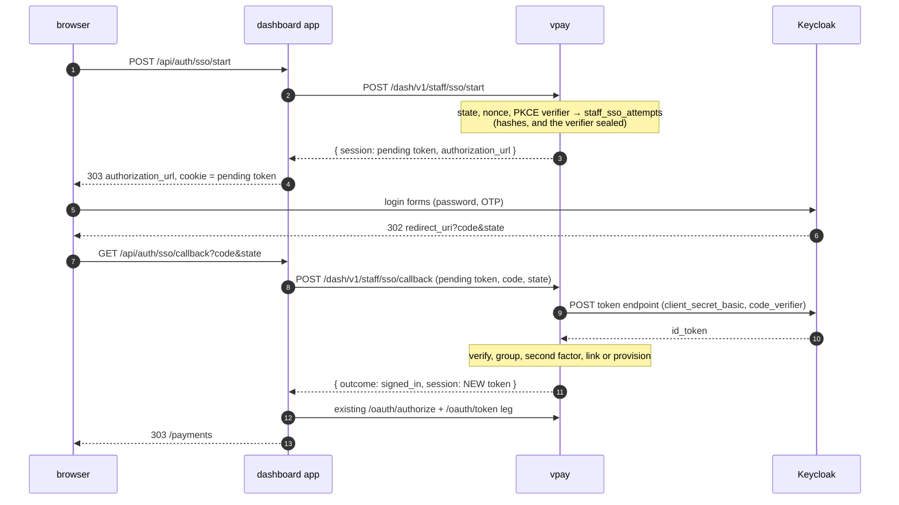

# ADR-0030: Staff sign-in federates to an OpenID Connect provider

- **Status:** Accepted
- **Date:** 2026-10-19
- **Deciders:** the vpay maintainer, who took the four decisions ADR-0019 had
  reserved — R1 (for the `oidc` kind), R2, R3 and R4 — on 2026-10-19, and
  directed the broker design below. The wording of those four is in decisions
  5 to 8 in substance; where this ADR goes beyond what was said (decisions 3, 4,
  9 and 10), it says so and the agent that wrote it made the call.
- **Amends:**
  - [ADR-0009](0009-dashboard-oidc-provider.md): its Context says vpay runs the
    OP "rather than federating to an external IdP", and
    `docs/flows/dashboard-auth.md` repeated it as "never federates". That stays
    true of **tokens** and stops being true of the **human step**: see
    decision 1, which says precisely what federates and what does not.
  - [ADR-0017](0017-staff-authentication.md) decision 1: staff now have a
    second way to prove who they are. What that ADR decided about argon2id,
    TOTP, the replay guard, mandatory enrolment, the one-time password, the
    session bounds and the rate limiter is **unchanged in every particular**,
    and is the break-glass path (decision 9).
  - [ADR-0019](0019-credential-model.md): answers its reserved R1 (for the
    `oidc` kind only), R2, R3 and R4. It implements the first of the six
    declared-and-unimplemented kinds, so that ADR's "eight are declared and two
    are implemented" is **three** from here. `hotp`, `magic_link`, `email_otp`,
    `phone_otp` and `webauthn` are exactly as they were, and R1 for them is
    **still reserved**.
- **Implementation:** the change that carries this ADR. Its verification page,
  [2026-10-20-staff-oidc-sso.md](../status/verification/2026-10-20-staff-oidc-sso.md),
  says what was run, what a real Keycloak showed, and what was not run.

## Context

ADR-0019 made federation a shape the schema can hold — a `credentials` row of
kind `oidc` is `(issuer, subject)` and no secret — and refused to implement it:
"a vocabulary entry is a shape the schema can hold, not a feature". It left four
decisions with the maintainer because each one is a policy a slice must not pick
in passing. On 2026-10-19 the maintainer took them and asked for staff to sign
in to the dashboard through the deployment's Keycloak.

Two facts about the starting point shape everything below.

**vpay is the OP for `/dash/v1`, and the invariant is about tokens.**
`docs/flows/dashboard-auth.md` opens with "No `/dash/v1` request runs without a
token vpay itself issued, signed with a key vpay itself rotates, against a client
vpay itself registered". Nothing in this ADR touches that sentence's content;
the sentence after it ("never federates to an external IdP") was a statement
about _how the invariant was achieved_, and it is the one that needs to say what
now federates.

**`authkestra_op::handle_authorize` authenticates nobody.** It takes an
already-authenticated `Identity`. ADR-0017 supplied one from a session that a
password and a TOTP code promoted. The smallest change that federates the human
step is therefore a _different way to promote a session_, and nothing in the
grant has to move.

## Decision

### 1. Broker, not pass-through: only the human step federates

A person presses "Sign in with Keycloak", signs in at Keycloak, and Keycloak
sends the browser back with a code. vpay redeems the code, **verifies the
id_token, reads its claims, and discards it**. What vpay then does is exactly
what ADR-0017's TOTP step does on success: it ends with an `authenticated`
`staff_sessions` row, and the dashboard runs the existing authorization-code
leg against vpay's own `/dash/v1/oauth/authorize` and `/token`.

So what federates is _who the person is_. What does not: the access token, the
session, the `/dash/v1` token and its signing key. The provider's access token
is never read, `userinfo` is never called, and neither provider token is stored,
logged or sent to a browser. `docs/flows/dashboard-auth.md`'s sentence is
corrected to say this.

### 2. Configuration is `staff_auth.sso`, and its presence is the whole switch

One block, one provider, per deployment: `issuer`, `client_id`, `client_secret`
(a `${VAR}` in livemode, like every secret in the document), `redirect_uri`,
`scopes` (default `openid email profile`), `required_group`, `groups_claim`
(default `groups`), `accepted_acr`, `accepted_amr`. `redirect_uri` is **the
dashboard's** callback, `https://<dashboard origin>/api/auth/sso/callback`:
the dashboard receives the `code` and hands it to vpay server-side, so a code
never reaches a vpay origin through a browser.

There is no `enabled` key and no default-off toggle. A deployment that writes
the block offers SSO; one that does not, does not. Boot refuses (a) a block with
no `dashboard_client` (a provisioned member needs a tenant), (b) a block without
both staff secrets (the staff login would not mount, and a configured block that
silently does nothing is the state this repository refuses), (c) a malformed
`issuer`/`redirect_uri`, a `scopes` without `openid`, a blank `required_group`,
(d) a literal `client_secret` in livemode, and (e) a block that names no way to
prove a second factor (decision 6).

### 3. Discovery is lazy and strict; keys come from one place

`<issuer>/.well-known/openid-configuration` is fetched on first use and cached
for an hour. It is refused unless its `issuer` equals the configured string
**byte for byte** — no trailing-slash tolerance, no case folding. Refused too:
a document that advertises PKCE methods without `S256`, or token-endpoint
authentication methods without `client_secret_basic` (the two things vpay
sends), or an endpoint whose scheme differs from the issuer's or that carries
credentials or a fragment.

The signing keys are fetched from the `jwks_uri` _that document names_ by a
cache (`jwks_cache.rs`'s `KeySetCache`) that has no method taking a URI: it
cannot be asked for another issuer's keys, which is ADR-0019 decision 5's
"which issuers a deployment accepts is configuration" made structural. It
re-fetches on an unknown `kid` at most once every 30 seconds, skips keys
declared for encryption, and keeps elliptic-curve keys whole — which
`authkestra_resource`'s `Jwk`, the type `JwksCache` stores, cannot.

Discovery is lazy so that a provider outage at boot costs the SSO button and
nothing else: password + TOTP and `/v1` are unaffected, and the first attempt
after the provider returns discovers it. A refresh that fails keeps serving the
last good document.

### 4. The flow, and where its secrets live

`staff_sso_attempts` (migration 0050) holds one row per flow in flight: the
SHA-256 of the pending token, of the `state` and of the `nonce`, and the PKCE
verifier **sealed** with the AES-256-GCM key that already seals TOTP secrets
(it cannot be hashed — the token request presents the raw value). Ten-minute
lifetime. The row is **consumed by `DELETE`**, and the delete's row count is the
answer to "did I win", so two callbacks racing on one flow have exactly one
winner (`racing_takes_of_one_sso_flow_yield_exactly_one_winner`). A wrong
`state`, a refused code and a bad token all leave the flow gone: the pending
token is a one-shot credential.

**This is a decision the agent made, not the maintainer.** The brief proposed a
`pending_sso` stage on `staff_sessions`. That table's `staff_id` is `NOT NULL`
and a real foreign key, and at this point in a first sign-in there is no staff
member; making it nullable would put a `NULL` into the column every session read
depends on, on a row an unauthenticated route can create. A separate table also
lets the callback **mint a fresh session token** rather than promote the one the
browser has held since before it authenticated, which closes session fixation by
construction. The cost is one table, one migration and a callback response that
returns a new token (the dashboard replaces its cookie); the schema of
`staff_sessions` and every read of it are untouched.

`start` is behind the sign-in rate limiter, per address, spending from the same
`sign_in:address` bucket the password leg spends from — a new scope would need a
migration for a counter whose job is identical. It sweeps expired attempts as it
runs, because it is an unauthenticated write path. The callback has no budget of
its own: it is unreachable without a pending token `start` minted, so its volume
is `start`'s.

### 5. How the id_token is verified (and what is not trusted)

In this order: the header's algorithm against an allow-list of **asymmetric**
algorithms (RS256/384/512, PS256/384/512, ES256/384 — `none` and every HMAC are
absent, and the token cannot choose one that is not offered); a `kid`, required;
the signature against the issuer's key for that `kid`, and the key's own `alg`
and `use` if declared; `iss` equal to the configured issuer byte for byte; `aud`
containing the `client_id`; `azp`, when present, equal to it, and _required_
when `aud` names more than one party; `exp` with `jsonwebtoken`'s default 60
seconds of leeway (the convention `resource_auth` already lives under); `iat`
present and not in the future beyond the same leeway; `sub` present, non-empty
and within OpenID Connect Core §2's 255 characters; `nonce` equal to the flow's
(by hash, in constant time).

The claims vpay reads for policy are `sub`, `groups` (or the configured claim),
`acr`, `amr`; for display only, `email`, `name`/`preferred_username`. **No claim
is ever matched against an email, and none reads or writes `is_admin` or
`merchant_id`** (decision 8).

### 6. R1 for the `oidc` kind: an id_token is accepted only if it proves a second factor

Its `acr` is in `accepted_acr`, **or** its `amr` intersects `accepted_amr`.
Exact string comparison; an empty list accepts nothing. Both lists empty is a
boot refusal in every deployment — fail closed — and either may be empty while
the other is not. R1 for every _other_ kind stays reserved, and nothing here
enables a single-factor method.

**What Keycloak 26.6.1 actually issues** (measured 2026-10-19 and 2026-10-20 on
`quay.io/keycloak/keycloak:26.6.1`, against `backends/tests/integration/tests/fixtures/keycloak-realm.json`;
the verification page has the transcripts):

| Sign-in                                                                                 | `acr` | `amr`            |
| --------------------------------------------------------------------------------------- | ----- | ---------------- |
| Default browser flow, password + OTP, `oidc-amr-mapper` on the client                   | `"1"` | `[]` — **empty** |
| Same, after giving the flow's executions `default.reference.value` (`pwd`, `otp`)       | `"1"` | `["pwd","otp"]`  |
| First sign-in of a person whose OTP is **enrolled during it** (`CONFIGURE_TOTP`)        | `"1"` | `["pwd"]`        |
| Repeat sign-in from Keycloak's SSO cookie, **inside** a second of the original          | `"0"` | `["pwd","otp"]`  |
| Repeat sign-in from the SSO cookie, 2.5 s later, **without** `default.reference.maxAge` | `"0"` | `[]`             |
| The same, with `default.reference.maxAge` = 28800 on both executions                    | `"0"` | `["pwd","otp"]`  |

So `acr "1"`/`"0"` proves nothing about a second factor — it is a level, not a
method — and the production rule is `accepted_amr: ["otp"]`, `accepted_acr: []`.
That rule **only works if the realm is set up for it**: `amr` is empty until the
executions carry a `default.reference.value`, and it does not survive an
SSO-cookie re-entry past about a second until they carry a
`default.reference.maxAge`. Both are realm settings an operator makes, and
`docs/flows/dashboard-auth/sso.md` lists them. (The second-last row corrects an
earlier measurement of 2026-10-19 that saw `amr` survive re-entry: that run was
inside the one-second window. A test that crossed a second boundary failed two
runs in eight until this was found.)

**The one `prompt=login` retry.** Two of those rows are a person who _did_ use a
second factor and carries a token that says only `["pwd"]` or nothing. Refusing
them would lock out every first sign-in and every sign-in with a stale SSO
cookie. So: when a token's **only** defect is that it does not prove a second
factor — signature, `iss`, `aud`, `azp`, `exp`, `iat`, nonce, state, group and
the disabled check have all passed — and the flow was not itself the retry, the
callback does not refuse. It starts a fresh flow (new state, nonce and PKCE
pair, recorded `is_retry`) whose authorization URL carries `prompt=login`, and
the response is `{"outcome":"reauthenticate", …}`; the dashboard sends the
browser back to Keycloak, which re-runs its forms. A retry whose token still
fails the rule is refused: at most one retry, no loop. Any _other_ defect is
refused immediately and earns no retry; that ordering is why the group gate and
the disabled-member check come before the second-factor decision.
`no_other_failure_earns_a_retry` asserts it with tokens that _also_ lack the
second factor, so a retry would be the outcome if the order were wrong.

What this trusts, stated rather than glossed: `acr` and `amr` are the provider's
assertion. vpay cannot tell that `["pwd","otp"]` means a TOTP was presented; it
trusts the realm to have said it truthfully. That is the same trust as trusting
the provider's `sub`.

### 7. Group gate and just-in-time provisioning (R4)

A person must be in `required_group` (compared exactly: no case folding, no path
handling) to sign in at all. The first successful SSO sign-in of such a person
creates the staff member, if no `credentials` row of kind `oidc` for this
`(issuer, subject)` exists — **in one transaction with the link**
(`provision_federated_staff_in_tx`, CrateStack's `run_in_tx`, so the generated
data layer survives). `vpay-server staff add` does **not** grow a `--kind`; SSO
members come only from this path.

Linking is by `(iss, sub)` and by nothing else — ADR-0019 decision 5 stands. The
`email` claim is written once, at provisioning, as display data. If the address
already belongs to a member that is not linked to this identity, the
provisioning is refused and **logged** — not linked. A concurrent first
sign-in of the same identity loses on `credentials_federated_identity_key`,
rolls back its new member, and signs in as the winner's. A token with no usable
address cannot provision.

**Not decided, and visible:** an existing password member cannot be linked to an
SSO identity at all (no claim may link by email, and no operator command links
by `(iss, sub)`). A deployment that wants its existing staff on SSO today
creates them anew through SSO and disables the old rows; a `staff link`
subcommand is the obvious follow-up and is the maintainer's call.

### 8. Roles stay local (R2)

No token claim reads or writes `is_admin` or `merchant_id`. A provisioned member
is `is_admin = false` with `merchant_id` = `dashboard_client.merchant_id`, and
`is_admin` is changed the way it always was. `roles_stay_local_whatever_the_token_claims`
puts `is_admin`, `merchant_id` and `roles` claims on a token and asserts nothing
moved.

### 9. Password + TOTP stays, unchanged, as break-glass

Its routes, wire shapes, sessions, rate limits and tests are exactly as they
were; `staff_sign_in.rs` passes with every assertion as written (one fixture
literal gained `sso: None`). An SSO-provisioned member holds no password, and
`POST /staff/login` answers them on the same dummy-hash path as an unknown
address (ADR-0019 decision 7), so the response time still distinguishes nobody.
The routes' count went from eight to eleven; that unit test's number moved with
it.

### 10. Issuer allow-list is per deployment (R3)

One issuer in `staff_auth.sso`. A `credentials` row whose issuer is not the
configured one **verifies nothing**: the lookup is by `(configured issuer, sub)`,
so the row is never found, and the same `sub` from the configured issuer is a
stranger (`a_credentials_row_for_another_issuer_verifies_nothing`). The row
carries the issuer string either way, so per-merchant issuers later change this
block's cardinality and no column.

## Consequences

- **A person removed from the IdP group keeps their vpay member and any live
  session.** The group is checked at each SSO sign-in, not continuously: a
  session lives up to 12 hours and a `/dash/v1` token 15 minutes after the
  group is gone. `staff_members.status = 'disabled'` remains the kill switch and
  takes effect on the next request. There is no back-channel logout and vpay's
  sign-out does not end the Keycloak session; a person signing out of vpay and
  pressing SSO again is signed straight back in from Keycloak's cookie.
- **No operator command disables a staff member**, as before; SQL is the tool.
- **An IdP outage is a `401` on the wire** ("staff sign-in refused"), with
  `sso identity provider unavailable` in the log. A `503` would tell an
  unauthenticated caller that SSO is configured and down. The cost is that the
  dashboard cannot say "try again later".
- **Operators must configure the realm** (decision 6). The two settings are the
  difference between SSO that works and SSO that sends every repeat sign-in
  round the forms; the callback logs `acr` and `amr` on every second-factor
  miss precisely so the cause is one line away.
- **The PKCE verifier is sealed under `staff_auth.totp_encryption_key`**, the
  key that already seals TOTP secrets — one key serving two purposes, accepted
  because AES-256-GCM with random nonces tolerates it and a third deployment
  secret is a real cost. Rotating that key also invalidates in-flight SSO flows,
  which live ten minutes.
- **Outbound HTTPS from the pod that serves `/dash/v1`** is new. The Helm chart's
  NetworkPolicy already allows 443 to non-private addresses; a private or
  in-cluster provider needs `networkPolicy.idpEgress`.
- **The IdP in the tests is the in-process `wiremock` crate**, not the
  `wiremock/wiremock` container the rail suites use: the container serves static
  mappings and these tests must serve tokens signed at run time with the flow's
  own nonce. It is a `[dev-dependency]` of the integration crate and unreachable
  from `vpay-server`; `verify-no-mocks` agrees. The real-Keycloak test is the
  complement.

## Reserved, still

- R1 for `hotp`, `magic_link`, `email_otp`, `phone_otp`, `webauthn`: unchanged.
- Linking an existing member to an SSO identity (decision 7).
- Whether SSO should be able to _require_ itself (disable password sign-in for
  members who have an SSO link). Nothing here does; the break-glass path is
  deliberately always on.
- Per-merchant issuers (decision 10) — when a real customer needs them.
