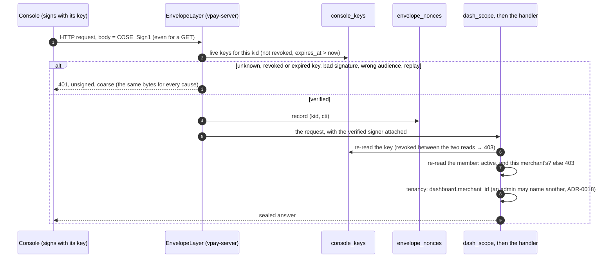

# Dashboard authentication

## The invariant

> **No `/dash/v1` request is handled unless it is a COSE_Sign1 message signed
> by a console key that is registered to an active member of the dashboard's
> merchant, was paired less than 30 days ago, has not been revoked, is addressed
> to this deployment, and has not been seen before. Every answer to such a request
> is a COSE_Sign1 message signed by this deployment.**

There is no password, no TOTP code, no session, no authorization code, no bearer
token and no federated sign-in on this surface. A person's identity on the wire
is a **P-256 key their browser generated and cannot export** (WebCrypto,
`extractable: false`), registered in `console_keys`; vpay's is one of the two
Ed25519 response keys that `/v1` is sealed with too. The mechanism is the same
cratestack signed transport [signed-transport.md](signed-transport.md) describes
for `/v1`; this page is what differs: who the signer is, how a key gets
registered, and how long it lives.

[ADR-0036](../adr/0036-the-console-is-a-signed-message-under-a-paired-key.md)
records the decision and the owner rulings behind it, and what it supersedes
([ADR-0017](../adr/0017-staff-authentication.md) and
[ADR-0030](../adr/0030-staff-sign-in-federates-to-an-oidc-provider.md) entirely).
[ADR-0008](../adr/0008-dashboard-scope.md) still decides what the dashboard is
for, and [ADR-0018](../adr/0018-cross-tenant-admin-reads.md) still decides which
tenant a request reads.

> **The dashboard application cannot sign in until VP-6b.** It still carries the
> sign-in screens, the cookie and the authorization-code exchange it had, and
> vpay has no server for them any more. The way in meanwhile is the break-glass
> below (`vpay-server staff pair-key`) and a client that signs requests;
> [`docs/status.md`](../status.md) says so.

## Pairing a key

A key reaches `console_keys` by exactly two doors, and both end in the same
function (`vpay_api::console_keys::store_key`).

```mermaid
sequenceDiagram
    autonumber
    participant B as Console (browser)
    participant P as Admin phone (vaam)
    participant V as vaam (service)
    participant S as /svc/v1 (vpay-server)
    participant D as Postgres

    B->>B: generate a non-extractable P-256 key
    B->>B: sign "vpay.console-pair.v1\n" + publicKey + "\n" + issuedAt
    B->>P: show the pairing request
    P->>V: the admin approves; vaam knows who the person is
    V->>S: POST /svc/v1/console_keys, COSE_Sign1 under vaam's Ed25519 key<br/>{vaam_user_id, public_key, possession_proof, issued_at}
    S->>S: the key is a service_clients key holding console_pairing?
    S->>S: shape of every field, then |now - issued_at| ≤ 300 s, then the proof
    S->>D: find (vaam, vaam_user_id), or provision a plain member of dashboard.merchant_id
    S->>S: an administrator? disabled? another merchant's? refuse
    S->>D: INSERT console_keys (expires_at = paired_at + 720 h)
    S-->>V: 201 {thumbprint, staff_member_id, expires_at, …} (200 for a repeat)
```

The second door is the break-glass (owner ruling Q2): an operator with database
access runs `vpay-server staff pair-key --staff <email|stf_…> --public-key <key>
[--label …]` for an **existing, active** member. It needs no proof of possession,
because the operator already holds more authority than a pairing grants; it
creates no member, changes no flag, and prints one line (`<staff id> <key id>
<thumbprint> <expires_at>`). It is also the **only** way a key reaches an
administrator, and `vpay-server staff add --admin` the only way one is made.

What a pairing never does (owner rulings R2 and 2026-10-09):

- **create or upgrade an administrator.** The body has no role field and
  `deny_unknown_fields` rejects one; the member provisioned is `is_admin =
false`, bound to `dashboard.merchant_id` from configuration; an existing
  member's flag is never written; and an already-linked administrator is refused
  (`403`, logged as such), because a service holding `console_pairing` can
  name any linked person;
- **name a tenant.** There is no field for one;
- **move or reinstate a key.** A thumbprint is unique for ever: another member's
  key is a `409`, and a revoked or expired key is the same `409`
  — the row is never deleted.

## One call



Everything in the layer is [signed-transport.md](signed-transport.md)'s: what a
signature binds (method, route, parameters, query, payload type, audience), the
Postgres replay cache, and the coarse refusal. Three things differ.

- **Three layers, not one.** `/dash/v1`'s hand-written reads, CrateStack's
  procedure transport under `/dash/v1/$procs/…` (a layer the generated module
  builds, because its route table and contract digests are private to
  `vpay-db`), and `/svc/v1` each have their own `EnvelopeLayer`, their own
  contract domain tag in `vpay-wire` (`vpay/dash-route-contract/v1`,
  `vpay/svc-route-contract/v1`) so one operation's digest is never another surface's,
  and a JSON payload type. A merchant's key is not a key on any of them: `/dash/v1`
  resolves signatures against `console_keys`, `/svc/v1` against `service_clients`,
  `/v1` against `merchant_clients`, and boot refuses one public key in two lists.
- **Revocation takes effect on the next request.** The resolver reads
  `console_keys` on every request and caches nothing. `DELETE
/svc/v1/console_keys/{thumbprint}` (or an operator's SQL) therefore ends a key
  at once; a key ends itself 30 days after `paired_at`, enforced by a `CHECK` and
  by the read, with no job to run.
- **A database that cannot answer is a `500`, never a miss.** Treating a failed
  key lookup as "no key" would make an outage look like a revocation, and treating
  it as "yes" would make it a bypass.

### What a refusal looks like

| Cause                                                                                                      | Answer                                                                                                              |
| ---------------------------------------------------------------------------------------------------------- | ------------------------------------------------------------------------------------------------------------------- |
| no signature, an unknown key, a revoked key, an expired key, a bad signature, the wrong audience, a replay | the layer's coarse `401` (`UNAUTHORIZED`), unsigned, identical bytes                                                |
| a write method (`POST`, `PUT`, `PATCH`, `DELETE`) on a read-only route                                     | the layer's own `405` with `Allow: GET` (a signed one: `415`) — before the router, whatever key signed it           |
| an anonymous bodiless `OPTIONS`                                                                            | the router's `405`; the layer lets a CORS preflight through and the scope step passes it on, so it is never a `500` |
| a verified key whose member is disabled, gone, or of another merchant                                      | sealed `403` — one answer for the three                                                                             |
| an administrator naming a merchant this deployment does not serve                                          | sealed `400` naming `merchant_id`                                                                                   |

## Where each piece lives

| Piece                                       | Where                                                                           |
| ------------------------------------------- | ------------------------------------------------------------------------------- |
| the table and its 30-day `CHECK`            | `backends/migrations/0056_console-keys.sql`                                     |
| the repository                              | `vpay_db::ConsoleKeys` (`backends/crates/vpay-db/src/console_keys.rs`)          |
| parsing a key, the proof, pairing, revoking | `vpay_api::console_keys`                                                        |
| the key resolver and the tenancy step       | `vpay_api::envelope::console`                                                   |
| `/svc/v1` and the capability check          | `vpay_api::svc`, `vpay_api::envelope::service`                                  |
| the registered services                     | `service_clients` in the YAML ([`vpay-config.md`](../reference/vpay-config.md)) |
| the one tenant                              | `dashboard.merchant_id` in the YAML                                             |
| the operations and their digests            | `backends/crates/vpay-wire`                                                     |
| the break-glass                             | `vpay-server staff pair-key` (`backends/apps/vpay-server/src/main.rs`)          |

## Services, and who may pair

`POST /svc/v1/console_keys` and `DELETE /svc/v1/console_keys/{thumbprint}` are
called by a **service**, never a person and never a merchant. A service is an
entry of `service_clients` — `client_id`, `capabilities`, and `cose_keys` in the
shape of a merchant's — read by the same code as `merchant_clients`, from a
separate list. **A capability is a field of that file and nothing else**: no HTTP
route, database row or environment variable can grant one, so granting
`console_pairing` is a reviewed configuration change, the way adding a merchant
is. The route table (`SVC_ROUTES`) names the capability each route needs and the
scope step enforces the row it was built from; a handler then demands a
`PairingAuthority`, a type only that step can construct. A service is switched
off with the merchants' kill switch (`disabled_clients`), effective on its next
request.

```yaml
dashboard:
  merchant_id: acme-cameroon-tenant

service_clients:
  - client_id: vaam
    capabilities: [console_pairing]
    cose_keys:
      - public_key: 11qYAYKxCrfVS_7TyWQHOg7hcvPapiMlrwIaaPcHURo   # Ed25519, unpadded base64url
        label: vaam-2026-10
```

## Status

Built in VP-6a (2026-10-26) and proven by `console_pairing.rs`,
`dashboard_read_surface.rs` and `dashboard_procedure_transport.rs` against a real
Postgres, with each guard broken in turn and its test seen to fail (see
[`docs/status/verification/2026-10-26-vp6a-console-keys.md`](../status/verification/2026-10-26-vp6a-console-keys.md)).

Not built, and not claimed:

- **The console's own sign-in (VP-6b)**: key generation in the browser, the
  pairing request, signing every request, the pairing screen on vaam's admin
  phone. Until it ships the dashboard application cannot reach this surface.
- **vaam's side of `/svc/v1`**: the registered service key and the call itself.
- **Listing a person's keys**: only pairing and revoking exist.
- **Rate limiting of `/svc/v1`.** The sign-in limiter went with the sign-in
  (`rate_limit_windows` and `RateLimits` remain as unused scaffolding); a
  pairing is a signed call from a registered service, not an anonymous one.
- **A run against a cluster.** Nothing here has been applied to one.
