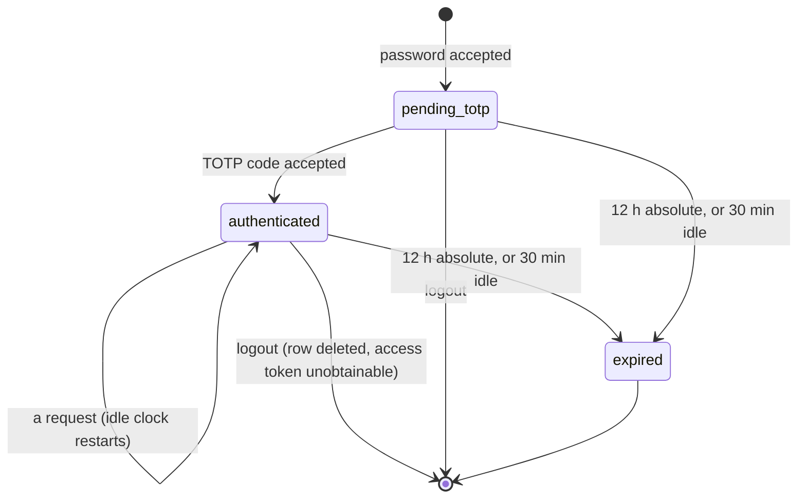

# Staff sign-in (`human_login`)

> A deployment that **serves** the `human_login` method accepts a staff access
> token on `/dash/v1` **beside** a console key. Which deployments those are is
> `auth.methods`' to say
> ([ADR-0037](../../adr/0037-authentication-methods-are-deployment-configuration.md),
> decision 8), and vaam's is not one of them. This page is the sign-in that
> method restores, from password to a `/dash/v1` read; the console key it sits
> beside is [../dashboard-auth.md](../dashboard-auth.md).
>
> With `staff_auth.sso` written the human step can instead federate to an OpenID
> Connect provider and end in the same session: [sso.md](sso.md) (VPA-4, and the
> dashboard's button and routes, VPA-5b).

## When it is served

`human_login` is served when `auth.methods` permits it (it does, by default) **and**
both its blocks are written: `staff_auth` (the password pepper and the TOTP key)
and `dashboard_client` (the one authorization-code client). Everything below is
that one condition, `AuthMethods::human_login_served`, asked in five places that
cannot disagree about it:

| What                                                     | Served                                                     | Not served                                            |
| -------------------------------------------------------- | ---------------------------------------------------------- | ----------------------------------------------------- |
| `/dash/v1/staff/*`, `/dash/v1/oauth/*`                   | mounted                                                    | the honest `404`                                      |
| `/dash/v1` and `/dash/v1/$procs/*` envelope              | `Optional` (`Off` with `keypair` off)                      | `Required`: an unsigned request is the coarse `401`   |
| the scope step, for a request the layer did not open     | validates a staff access token                             | `500` (the layer is not in front of this route)       |
| `/v1/oauth/{jwks.json,.well-known/openid-configuration}` | mounted on the management pod (it validates its own token) | mounted only where `machine_tokens` or MCP reads them |
| `vpay-server staff add`                                  | also writes a password and prints it once                  | writes the member and prints its `stf_…` id           |

Half a sign-in is refused at boot (`AuthMethodNotConfigured`), and so is a
block with the method left out of an explicit `auth.methods`
(`AuthMethodDisabled`). `dashboard.merchant_id` and `dashboard_client.merchant_id`
must name the same tenant when both are written (`DashboardTenantMismatch`):
`/dash/v1` reads exactly one.

## The flow

Two legs, and the first is vpay's own: `authkestra-op` authenticates nobody,
`handle_authorize` takes an already-authenticated `Identity` as a parameter, and
what produces one is the staff table and the routes in front of it
([ADR-0017](../../adr/0017-staff-authentication.md)).

```mermaid
sequenceDiagram
    autonumber
    participant B as Staff browser
    participant A as Dashboard app (server side)
    participant V as vpay (/dash/v1)
    participant D as Postgres

    B->>A: email + password
    A->>V: POST /staff/login
    V->>D: rate-limit windows (email, source address), then argon2id + pepper
    V->>D: INSERT staff_sessions (state pending_totp, id = SHA-256 of the token)
    V-->>A: {session, next: totp | totp_enrolment (+ otpauth URI, sealed secret)}
    B->>A: the six-digit code
    A->>V: POST /staff/totp  (X-Vpay-Staff-Session)
    V->>D: RFC 6238 ±1 step, then advance_counter (compare-and-swap)
    V->>D: session state authenticated
    A->>V: GET /oauth/authorize?code_challenge=…
    V->>D: exact redirect_uri match; one 60 s single-use code
    V-->>A: 302 ?code=…  (the app follows it, not the browser)
    A->>V: POST /oauth/token {code, code_verifier}
    V->>D: consume the code (compare-and-swap), PKCE S256
    V-->>A: access token (aud = client_id, vpay_merchant_id claim)
    A->>V: GET /payment_intents  Authorization: Bearer …
    V->>D: re-read the member, resolve the tenant
    V-->>A: the rows (plain JSON)
```

The dashboard app's own server follows the `302`, so a browser never sees a
code, a verifier or a token (ADR-0017 decision 4). The redirect URI is matched
byte for byte; PKCE is mandatory for every client on this grant.

## The session



The token is 256 bits from the OS CSPRNG and the table is keyed by its SHA-256,
so a dump of `staff_sessions` yields no usable session. Both bounds are checked
on **read** and delete nothing: an expired row is refused and left, so an
operator can tell "expired" from "never existed", while on the wire both are the
same `401`. `POST /staff/logout` **deletes** the row, which is a revocation: the
row carries the access token the exchange minted, so the dashboard's own server
can no longer obtain it, and the cascade kills any code the session issued. The
minted JWT stays valid for the rest of its TTL, and no design changes that.

## The cookie needs a secure origin

The dashboard application keeps the session token in two cookies on its own
origin, `__Host-vpay_dash_session` and `__Host-vpay_dash_enrolment`
(`frontends/apps/dashboard/src/server/cookies.ts`). Both are `HttpOnly`,
`Secure`, `SameSite=Lax`, `Path=/` and carry no `Domain`, which is what the
`__Host-` prefix requires: a browser refuses to store one that lacks any of
them, and so a sibling subdomain or a plain-`http` response cannot plant or
overwrite it.

| Where the dashboard is reached                                    | What happens                                                                                                                                                                                                             |
| ----------------------------------------------------------------- | ------------------------------------------------------------------------------------------------------------------------------------------------------------------------------------------------------------------------ |
| `https://…`                                                       | stored                                                                                                                                                                                                                   |
| `http://localhost:3000` (`next dev`, the compose stacks, Cypress) | stored by Chrome and Firefox, which treat localhost as a secure context. Safari has historically refused a `Secure` cookie over plain `http`; it was not tried                                                           |
| `http://` on any other host                                       | **stored by no browser.** The sign-in action succeeds and redirects, the next request carries no cookie, and `/` sends the browser back to `/login`: the sign-in does not stick. `Secure` was already unconditional here |

The sign-in does not branch on the environment to make the last row work
(AGENTS.md forbids it). Put the dashboard behind TLS, or reach it on
`localhost`.

The rename from `vpay_dash_session` signs out any browser that held the old
name: it is never read again and expires on its own. Nothing is revoked early
or kept alive by it.

## One answer for every refusal

No such address, wrong password, disabled account, wrong or replayed code,
expired, idle or forged session, a session at the wrong stage: all of them are
`ApiError::StaffSignInRefused`, one `401` with one sentence. The step that
refused is in the log (`stage`) and never in the body. An address with no
account, or a member with no password credential, still costs one argon2id
verification, so the answers are the same in time as well as in shape.

## Rate limits

Counted in Postgres (`rate_limit_windows`), so every replica spends from one
budget: ten sign-in attempts per five minutes per email **and** per source
address, five current-password attempts per session. An attempt over budget is
refused before any credential work, so the limit is not an amplifier. The
source address is the transport peer unless `staff_auth.trusted_proxies` names
the proxies whose `X-Forwarded-For` is believed; empty (the default) means one
budget per proxy, which behind a reverse proxy is the whole deployment's. The
server is served with `into_make_service_with_connect_info`; without it every
caller counts under one key.

## The token, and what a request must clear

`staff_auth.access_token_ttl_seconds` (10 to 3600, default 900). Audience
`dashboard_client.client_id` (the only audience the validator takes), scope the
registration's single scope, and `vpay_merchant_id` equal to the dashboard's
tenant: the claim nothing but this grant stamps, so a `client_credentials`
token can never read `/dash/v1`. The scope step then re-reads the member (active,
this merchant) and resolves the tenant through the **same** function a console
key goes through, so ADR-0018's admin override cannot read differently by door.
A method the surface does not serve (`POST` on a read, `GET` on the procedure
transport) is `403` before the token is looked at.

| Request                                            | Answer                                           |
| -------------------------------------------------- | ------------------------------------------------ |
| signed **and** `Authorization: Bearer`             | `400` naming `authorization`, sealed             |
| no signature, no token                             | `401` `missing_bearer_token`                     |
| a token that does not validate                     | `401` `invalid_token`; `503` if the JWKS is down |
| a valid token without this tenant's claim or scope | `403`                                            |
| the member is disabled, gone or another tenant's   | `403`, one answer for all three                  |
| the database cannot answer                         | its own error, never a pass                      |

A session's answers are plain JSON where a key's are sealed, and carry no
contract-lock protection: that is the trade a deployment makes by serving the
method.

**There is no refresh token, and there never was one on this surface**
(ADR-0017; the owner's rulings of 2026-09-29 and 2026-10-09). The dashboard
client is registered for `authorization_code` alone, the OP's refresh slot is
the fail-closed `RefusingRefreshTokenStore`, and a `refresh_token` request to
the token endpoint is a `400` naming `grant_type` while the method is served and
a `404` when it is not. The owner's question of 2026-10-27 (Q8), whether the
grant is restored only where a legacy method is enabled, therefore has nothing
to restore: `the_refresh_token_grant_is_not_honoured_while_the_method_is_served`
holds it.

## JWKS and rotation

The token is signed by the process's RS256 key and validated against its own
`/v1/oauth/jwks.json` over loopback (`loopback_jwks_url`), so a pod need not
reach its own public hostname. The validator is built by
`ManagementEnvelope::with_staff_sessions`, the one constructor `serve` and the
integration harness share. The pod that mounts the sign-in must load the signing key (`--oauth-signing-key-file`) and announce it in
`oauth_signing_keys`, exactly as a business pod does; rotation overlap is
`op::keys::ROTATION_OVERLAP` (24 h), far above the token TTL.

## Recovering a member who lost a password or an authenticator

There is **no command** for either, and no way to set a password from SQL: a
hash needs the deployment pepper, which only the server holds. What an operator
can do is two statements' worth, run in `psql` as a role that can write
`staff_members` and `credentials`, with the address in lower case (the column is
checked lower-case):

- **Lost authenticator.** Delete the member's TOTP credential and their sessions.
  Enrolment is the absence of that row, so the member's next password sign-in
  enrols a fresh authenticator. Whoever holds the password can do that, so
  confirm who is asking before running it.
- **Lost password.** Delete the member and run `vpay-server staff add` again with
  the same `--merchant`, `--email`, `--name` and, for an administrator, `--admin`
  (read them first). The email unique index refuses a second `staff add` while
  the row exists, and deleting only the password credential would leave a member
  nobody can issue a password to. The delete cascades to the member's sessions,
  codes, credentials **and console keys**, so a paired key must be paired again,
  and the member's `stf_…` id changes.

The statements are in
[the deploy runbook](../../runbooks/deploy-and-rollback.md#staff-who-lost-a-password-or-an-authenticator).
A `staff remove`, `staff disable` or `staff reset-password` command is a gap,
named in [status/backend.md](../../status/backend.md).

## Not built

The pages that read `/dash/v1` and the signed reader they need
(VP-6b), a command to remove a member, disable one or reset a password (none
exists; see the section above for the SQL), and any proof against a deployment
that is running (the end-to-end cases are VPA-5c). The dashboard application's
password sign-in, authenticator step, forced password change, account page and
sign-out are built (VPA-5a), and so are its two SSO routes and its
single-sign-on button (VPA-5b, [sso.md](sso.md)): [`frontends/apps/dashboard/README.md`](../../../frontends/apps/dashboard/README.md)
says how, and [status/frontend.md](../../status/frontend.md) says what was
measured.

## Tests

- `backends/tests/integration/tests/staff_sign_in.rs`: the real router on a real
  socket over Postgres, from `staff add` to a read, including
  `a_session_bearer_and_a_console_key_both_read_dash_v1` and
  `with_the_method_off_the_staff_routes_404_and_dash_refuses_unsigned_requests`.
- `backends/crates/vpay-api/src/human_login_tests.rs`: the same gates without a
  database, one assertion per row of the tables above.
- `backends/apps/vpay-server/tests/cli.rs`:
  `staff_add_mints_a_one_time_password_only_where_human_login_is_served`, and,
  for the wiring only `serve` performs,
  `a_management_pod_serving_human_login_mounts_its_jwks_and_session_validator`:
  a real process on `deployment.surfaces: [management]` answers the JWKS and the
  sign-in route, refuses an unsigned read with `missing_bearer_token`, and exits
  `78` naming `staff_auth` on a 31-byte TOTP key.
- Single sign-on (VPA-4) has its own suites, listed on [sso.md](sso.md):
  `staff_sso.rs`, `staff_sso_keycloak.rs`, and
  `a_management_pod_offers_staff_sso_exactly_when_the_block_is_written` in
  `tests/cli.rs`.
