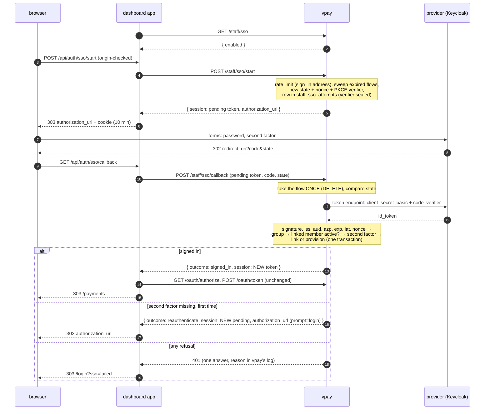
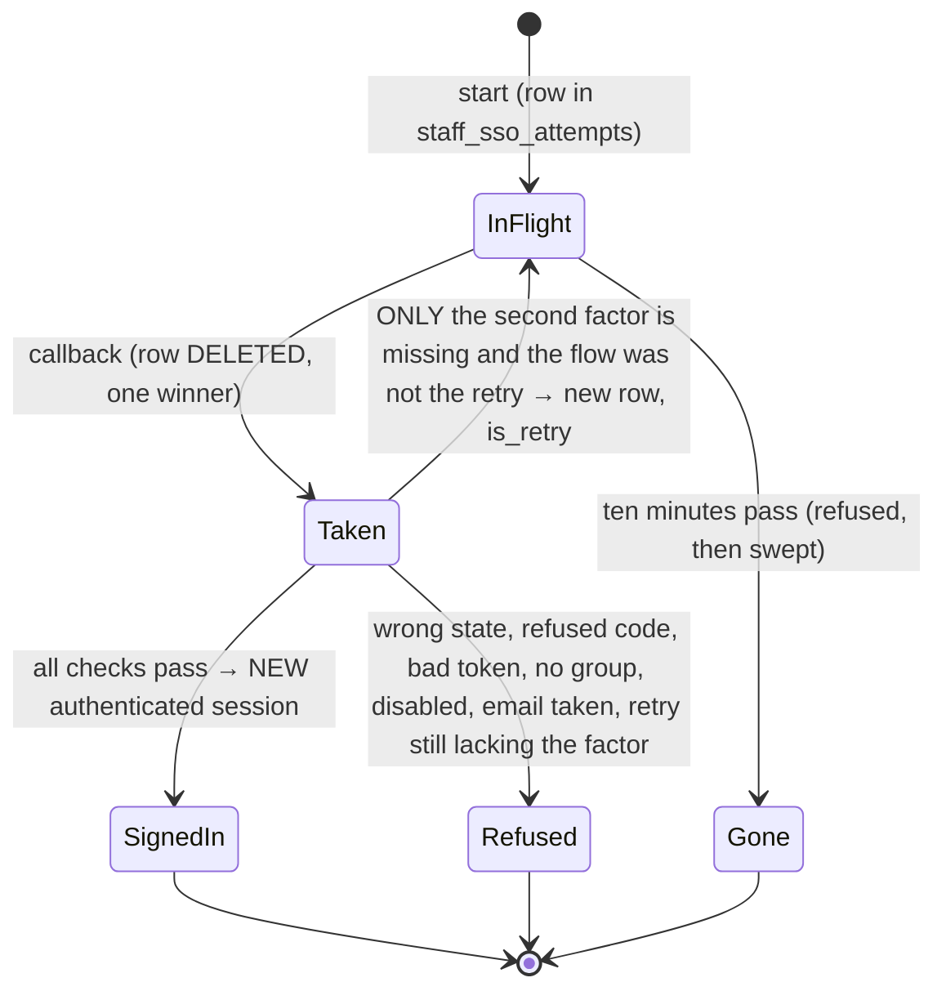

# Dashboard auth — single sign-on through an OpenID Connect provider

_Added 2026-10-20 with [ADR-0030](../../adr/0030-staff-sign-in-federates-to-an-oidc-provider.md),
which holds every decision below and the reasoning for it. Deleted 2026-10-26
(VP-6a) and **restored 2026-10-30 (VPA-4)** as a part of the `human_login`
method ([ADR-0037](../../adr/0037-authentication-methods-are-deployment-configuration.md)
decision 8). This page is the process: what happens, in what order, what can go
wrong, what an operator must set up, and what is built._

## When it is served

SSO is served exactly when `human_login` is **and** `staff_auth.sso` is written.
There is no switch of its own: the block's presence is the switch, and the block
is a sub-block of `staff_auth`, so the method rules already cover it.

| `auth.methods`       | `staff_auth.sso` | What the three routes do                                                                  |
| -------------------- | ---------------- | ----------------------------------------------------------------------------------------- |
| serves `human_login` | written          | `GET /staff/sso` says `enabled: true`; `start` and `callback` work                        |
| serves `human_login` | absent           | `enabled: false`; `start` and `callback` are the honest `404`                             |
| does not permit it   | written          | **boot refusal**, `AuthMethodDisabled` naming `staff_auth` (the block that carries `sso`) |
| does not permit it   | absent           | the staff routes are not mounted at all (`404`)                                           |

A provider that cannot be constructed (the fixed TLS stack failing) is a boot
refusal too (`StaffLoginError::Unusable`, exit `78`), where before VPA-4 an SSO
block that failed to build logged and fell back to password and TOTP. Discovery
stays lazy, so an unreachable provider at boot costs the SSO button, not the
process.

**What federates is the human step, and nothing else.** vpay is still the
OpenID Provider for `/dash/v1`: a successful SSO callback ends in the same
`authenticated` `staff_sessions` row the TOTP step ends in, and the dashboard
then runs the unchanged authorization-code leg. The provider's id_token is
verified, its claims read, and it is discarded; its access token is never read.

## The sign-in

The routes are the three new entries in `STAFF_ROUTES`
(`backends/crates/vpay-api/src/staff/mod.rs`), implemented in
`backends/crates/vpay-api/src/staff/sso/` (`mod.rs` the handlers, `provider.rs`
discovery and the token request, `verify.rs` the id_token, `error.rs` the
log-only reasons).

### What a flow is, over its life

`Taken --> InFlight` is the only edge back, and the row it creates carries
`is_retry`, which a callback that finds it set can only refuse: "at most one retry" is a property of
the data. `InFlight --> Taken` is a `DELETE ...` whose row count decides the
race, so there is no state in which two callbacks both proceed.

## Members kept through 0056

Migration 0056 deleted the `password` and `totp` credentials and **kept** the
`oidc` ones; migration 0058 (VPA-2) restored the tables and their constraints and
changed nothing in `credentials` rows. A person who had signed in through SSO
before VP-6a therefore still has a `credentials` row `(kind 'oidc', issuer,
subject)` pointing at their `staff_members` row, and nothing has to be done for
them: the callback looks the verified `(iss, sub)` up with
`find_federated` and signs that same member in, with their `stf_…` id, their
tenant and their `is_admin` as they were. The link is the pair and nothing else,
so a changed issuer string orphans the old links (the new issuer provisions
members anew) and an email is never matched. `staff_sso::an_oidc_credential_kept_through_0056_resolves_to_its_member`
seeds exactly such a row and proves it.

## What can go wrong, and what the person sees

Every refusal is the same `401` and the same sentence as the password and TOTP
legs; the dashboard turns it into one generic message on `/login`. The reason is
in vpay's log, prefixed `sso`, and carries no token, code, secret or claim
value:

| Log stage                                        | Meaning                                                                         |
| ------------------------------------------------ | ------------------------------------------------------------------------------- |
| `sso identity provider unavailable`              | discovery, token endpoint or key set unreachable or unusable                    |
| `sso discovery document refused`                 | its `issuer` is not the configured one byte for byte, no `S256`, a bad endpoint |
| `sso flow absent, expired or already used`       | no/unknown/spent/expired pending token                                          |
| `sso state mismatch`                             | the `state` is not the flow's (the flow is burned)                              |
| `sso authorization code refused by the provider` | `400`/`401` from the token endpoint                                             |
| `sso id_token header refused`                    | algorithm outside the allow-list (`none`, HS*), no `kid`                        |
| `sso id_token signed by an unpublished key`      | unknown `kid` after the one throttled re-fetch                                  |
| `sso id_token refused`                           | signature, `iss`, `aud`, `azp`, `exp`, `iat`, `sub`                             |
| `sso nonce mismatch`                             | the token is not for this flow                                                  |
| `sso person not in the required group`           | group gate                                                                      |
| `sso id_token proves no second factor`           | refused **after** the one retry                                                 |
| `sso linked staff member disabled`               | `staff_members.status = 'disabled'`                                             |
| `sso email belongs to an unlinked staff member`  | JIT refused; never linked by email                                              |

On a second-factor miss the callback also logs the token's `acr` and `amr`
(`info`), because the commonest misconfiguration is a realm whose `amr` is not
what `accepted_amr` assumes.

## What an operator must set up at the provider

For Keycloak 26.6.1 (measured; other providers have their own spelling of the
same three things):

1. **A confidential client** with `client_secret_basic`, PKCE `S256`, the
   dashboard's `…/api/auth/sso/callback` as a valid redirect URI, and two
   protocol mappers on it: `oidc-group-membership-mapper` (claim `groups`,
   `full.path` **false**, add to ID token) and `oidc-amr-mapper` (add to ID
   token).
2. **A browser flow whose executions carry an `amr` reference**:
   `default.reference.value` = `pwd` on the username/password form and `otp` on
   the OTP form. Without it a password + OTP sign-in's `amr` is **empty**.
3. **`default.reference.maxAge` on both**, set to the SSO session length
   (e.g. `28800`). Without it Keycloak drops `amr` from a token issued off its
   SSO cookie after about a second, and every repeat sign-in is sent round the
   forms by vpay's retry.
4. **`staff_auth.sso.accepted_amr: ["otp"]`** and `accepted_acr: []`. Keycloak's
   `acr` is `"1"` after a password alone and `"0"` on an SSO-cookie re-entry;
   it says nothing about a second factor.

`backends/tests/integration/tests/fixtures/keycloak-realm.json` is a working
realm import with all of it, and `staff_sso_keycloak.rs` boots Keycloak with it.

**On the network side, in the Helm chart.** The pod that serves `/dash/v1`
(`-management` when `management.enabled`, otherwise `-server`) opens outbound
HTTPS to the provider for discovery, the key set and the token endpoint. With
`networkPolicy.enabled`, a public provider on 443 is already reachable through
`networkPolicy.railsEgress`. A provider on a private address or in the cluster,
on another port, or any provider once `railsEgress.enabled` is false needs
`networkPolicy.idpEgress` (restored 2026-10-30, VPA-4, as #383 deleted it; never
the worker, and not `-server` once the tiers are split). The chart's
[README](../../../deploy/helm/vpay/README.md) ("Egress to the staff identity
provider under `networkPolicy`") has the values and the limits of the schema's
guard.

A person whose OTP is **enrolled during** the sign-in (Keycloak's
`CONFIGURE_TOTP` required action) gets a token whose `amr` is `["pwd"]` only.
That is the case the retry exists for: vpay sends the browser back with
`prompt=login`, Keycloak re-runs its forms (password only, the user being
remembered, then the OTP form), and the second token carries `otp`.

## The dashboard application (VPA-5b)

_Built 2026-10-30._ The sequence above is what the application does:
`frontends/apps/dashboard` serves `POST /api/auth/sso/start` and
`GET /api/auth/sso/callback` (`src/server/sso.ts`) and draws the button
(`src/components/sso-sign-in.tsx`) on `/login`.

- **The button** is drawn when discovery serves `human_login` **and**
  `GET /staff/sso` says `enabled: true` **and** the container knows the
  provider's origin (an `https` issuer, or `http` on a loopback host).
  `enabled: false` draws nothing. A status read that fails
  says "Single sign-on could not be checked" with the request id and keeps the
  password question; it never hides the button silently.
- **The callback path must equal the path of `staff_auth.sso.redirect_uri`.**
  The route is `/api/auth/sso/callback`, so the block's `redirect_uri` is
  `https://<dashboard origin>/api/auth/sso/callback`, and the provider's client
  lists exactly that. It is **not** `dashboard_client.redirect_uris`, whose
  string is never visited. `sso-paths.test.ts` ties the route file to the
  constant.
- **The pending token has its own cookie**, `__Host-vpay_dash_sso_pending`
  (httpOnly, Secure, Lax, `Path=/`, no `Domain`, ten minutes, vpay's own bound on
  a flow). `signed_in` writes the new token over the session cookie, whatever it
  held (no session fixation), and clears the pending one; the gate on `/` then
  mints the `/dash/v1` token. `reauthenticate` replaces the pending cookie and
  `303`s to the provider again. Any other outcome clears the pending cookie and
  lands on `/login?sso=failed`, with no reason: the reason is in vpay's log.
- **Where the browser may be sent.** vpay chose `authorization_url` and the
  application follows it, so it is followed only if it is `https` (`http` for a
  loopback host, a development stack), on the origin of
  `VPAY_DASHBOARD_SSO_ISSUER` (the issuer URL, reduced to its origin), with no
  `user:pass@` and no fragment. There is no `return_to`: a success lands on `/`.
- **Every response** of both routes carries `Cache-Control: no-store` and
  `Referrer-Policy: no-referrer`: a callback's URL holds a one-time code.
  `start` checks the request's `Origin` first, as the server actions do; the
  callback cannot, being a cross-site navigation by construction.
- **The callback waits longer than any other call.** vpay's callback consumes
  the sign-in attempt first, then calls the provider with a ten-second timeout
  of its own, which covers a token exchange and, on a cold cache, a JWKS fetch.
  The application gives that one call 25 seconds (`SSO_CALLBACK_TIMEOUT_MS`);
  every other call keeps five. A shorter wait would show `sso=failed` while vpay
  may still mint a session.
- **The session a sign-in replaces is revoked, best effort.** If the browser
  held a session cookie when `signed_in` arrived, the application asks vpay to
  delete that session through the call sign-out makes, with a two-second
  deadline (`SSO_REVOKE_TIMEOUT_MS`). A failure of any kind is ignored and the
  sign-in goes ahead; the old row then expires on its own bounds.
- **A refused redirect leaves one line in the log**, naming the refused URL's
  origin and the configured issuer's origin and nothing else: the URL carries
  `state`, the nonce and the PKCE challenge.
- **Limits.** A provider whose authorization endpoint is on another origin than
  its issuer is refused (the origin rule compares the two byte for byte). Three
  such providers are known: AWS Cognito (the hosted UI is on the user pool's
  domain, not the issuer's), Entra ID v1 (an issuer on `sts.windows.net`, an
  authorization endpoint on `login.microsoftonline.com`) and Azure AD B2C behind
  a custom domain. Supporting one is a decision for whoever deploys it, not a
  default. An `http` issuer counts as configured only on a loopback host; any
  other reads as unset, and `/login` shows the not-configured notice instead of
  a button that could only fail.

**Upgrade note.** The application needs `staff_auth.sso` written (VPA-4) with
`redirect_uri` set to `https://<dashboard origin>/api/auth/sso/callback`, and
**one new environment variable**, `VPAY_DASHBOARD_SSO_ISSUER`, the same issuer
URL `staff_auth.sso.issuer` carries. It is optional: without it the button is
not offered and `/login` says which variable to set. Nothing else is new — the
three client values and `VPAY_DASHBOARD_PUBLIC_ORIGIN` are VPA-5a's. The Helm
chart does not template the new variable yet (the chart's dashboard values are
VPA-5c's).

[The VPA-5b page](../../status/verification/2026-10-30-vpa5b-dashboard-sso.md)
has the tests and the sabotage log.

## Status

**Restored 2026-10-30 (VPA-4) on the server; built, and proven at three levels.** `staff_sso.rs` drives the real router over
a real Postgres against an identity provider simulated over HTTP, with tokens
signed by a key the test generates; `staff_sso_keycloak.rs` does the same
against a real `quay.io/keycloak/keycloak:26.6.1` container, scripting the
browser's half (login form, OTP form, `CONFIGURE_TOTP`, `prompt=login`, SSO
cookie re-entry); and `verify.rs`, `jwks_cache.rs`, `vpay-db` and `vpay-config`
carry the unit and repository cases. The
original counts are on
[its verification page](../../status/verification/2026-10-20-staff-oidc-sso.md);
the restoration's, with the sabotage log, are on
[the VPA-4 page](../../status/verification/2026-10-30-vpa4-staff-sso.md).
`staff_sso_keycloak.rs` needs Docker and pulls a JVM image; like every
testcontainers suite it has no `#[ignore]` and no feature gate (`just
verify-ignored` pins zero), and a machine without a Docker daemon fails it
rather than skipping it.

**Not built, and none of it is implied above:**

- **No browser has completed it.** The two routes are proved against a stubbed
  `fetch` and the page in jsdom and Chromium (contrast); no end-to-end case
  drives them (VPA-5c), and none ran against Keycloak or any provider.
- **No way to link an existing member to an SSO identity.** Members are created
  by first sign-in; password members stay password members.
- **No back-channel or RP-initiated logout.** Signing out of vpay does not end
  the provider's session; a person who signs out and presses SSO again is signed
  straight back in from the provider's cookie.
- **No continuous group check.** A person removed from the group keeps a live
  session (up to 12 hours) and token (15 minutes); disabling the member is the
  kill switch.
- **No `userinfo` call, no refresh token, no provider token stored.**
- **Never exercised in a cluster, behind a real ingress, or against any provider
  but Keycloak 26.6.1.**
