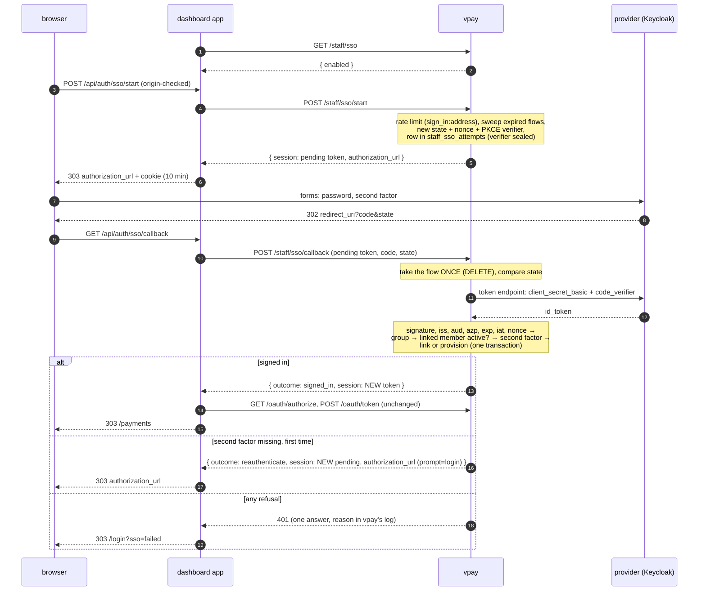
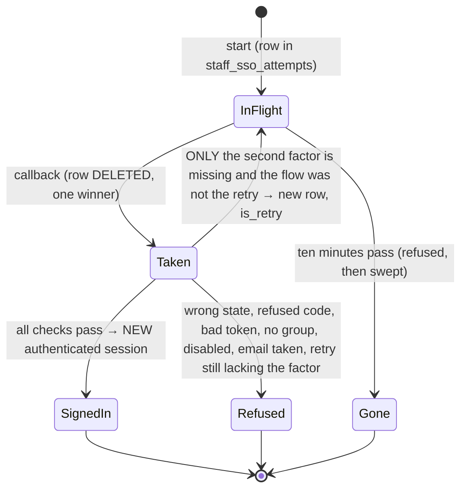

# Dashboard auth — single sign-on through an OpenID Connect provider

_Added 2026-10-20 with [ADR-0030](../../adr/0030-staff-sign-in-federates-to-an-oidc-provider.md),
which holds every decision below and the reasoning for it. This page is the
process: what happens, in what order, what can go wrong, what an operator must
set up, and what is built._

**What federates is the human step, and nothing else.** vpay is still the
OpenID Provider for `/dash/v1`: a successful SSO callback ends in the same
`authenticated` `staff_sessions` row the TOTP step ends in, and the dashboard
then runs the unchanged authorization-code leg. The provider's id_token is
verified, its claims read, and it is discarded; its access token is never read.

## The sign-in

The routes are the three new entries in `STAFF_ROUTES`
(`backends/crates/vpay-api/src/staff/mod.rs`), implemented in
`backends/crates/vpay-api/src/staff/sso/` (`mod.rs` the handlers, `provider.rs`
discovery and the token request, `verify.rs` the id_token, `error.rs` the
log-only reasons).

### What a flow is, over its life

`Taken --> InFlight` is the only edge back, and the row it creates carries
`is_retry`, which a callback that finds it set can only refuse: "at most one retry" is a property of
the data. `InFlight --> Taken` is a `DELETE ...` whose row count decides the
race, so there is no state in which two callbacks both proceed.

## What can go wrong, and what the person sees

Every refusal is the same `401` and the same sentence as the password and TOTP
legs; the dashboard turns it into one generic message on `/login`. The reason is
in vpay's log, prefixed `sso`, and carries no token, code, secret or claim
value:

| Log stage                                        | Meaning                                                                         |
| ------------------------------------------------ | ------------------------------------------------------------------------------- |
| `sso identity provider unavailable`              | discovery, token endpoint or key set unreachable or unusable                    |
| `sso discovery document refused`                 | its `issuer` is not the configured one byte for byte, no `S256`, a bad endpoint |
| `sso flow absent, expired or already used`       | no/unknown/spent/expired pending token                                          |
| `sso state mismatch`                             | the `state` is not the flow's (the flow is burned)                              |
| `sso authorization code refused by the provider` | `400`/`401` from the token endpoint                                             |
| `sso id_token header refused`                    | algorithm outside the allow-list (`none`, HS*), no `kid`                        |
| `sso id_token signed by an unpublished key`      | unknown `kid` after the one throttled re-fetch                                  |
| `sso id_token refused`                           | signature, `iss`, `aud`, `azp`, `exp`, `iat`, `sub`                             |
| `sso nonce mismatch`                             | the token is not for this flow                                                  |
| `sso person not in the required group`           | group gate                                                                      |
| `sso id_token proves no second factor`           | refused **after** the one retry                                                 |
| `sso linked staff member disabled`               | `staff_members.status = 'disabled'`                                             |
| `sso email belongs to an unlinked staff member`  | JIT refused; never linked by email                                              |

On a second-factor miss the callback also logs the token's `acr` and `amr`
(`info`), because the commonest misconfiguration is a realm whose `amr` is not
what `accepted_amr` assumes.

## What an operator must set up at the provider

For Keycloak 26.6.1 (measured; other providers have their own spelling of the
same three things):

1. **A confidential client** with `client_secret_basic`, PKCE `S256`, the
   dashboard's `…/api/auth/sso/callback` as a valid redirect URI, and two
   protocol mappers on it: `oidc-group-membership-mapper` (claim `groups`,
   `full.path` **false**, add to ID token) and `oidc-amr-mapper` (add to ID
   token).
2. **A browser flow whose executions carry an `amr` reference**:
   `default.reference.value` = `pwd` on the username/password form and `otp` on
   the OTP form. Without it a password + OTP sign-in's `amr` is **empty**.
3. **`default.reference.maxAge` on both**, set to the SSO session length
   (e.g. `28800`). Without it Keycloak drops `amr` from a token issued off its
   SSO cookie after about a second, and every repeat sign-in is sent round the
   forms by vpay's retry.
4. **`staff_auth.sso.accepted_amr: ["otp"]`** and `accepted_acr: []`. Keycloak's
   `acr` is `"1"` after a password alone and `"0"` on an SSO-cookie re-entry;
   it says nothing about a second factor.

`backends/tests/integration/tests/fixtures/keycloak-realm.json` is a working
realm import with all of it, and `staff_sso_keycloak.rs` boots Keycloak with it.

A person whose OTP is **enrolled during** the sign-in (Keycloak's
`CONFIGURE_TOTP` required action) gets a token whose `amr` is `["pwd"]` only.
That is the case the retry exists for: vpay sends the browser back with
`prompt=login`, Keycloak re-runs its forms (password only, the user being
remembered, then the OTP form), and the second token carries `otp`.

## Status

**Built, and proven at three levels.** `staff_sso.rs` drives the real router over
a real Postgres against an identity provider simulated over HTTP, with tokens
signed by a key the test generates; `staff_sso_keycloak.rs` does the same
against a real `quay.io/keycloak/keycloak:26.6.1` container, scripting the
browser's half (login form, OTP form, `CONFIGURE_TOTP`, `prompt=login`, SSO
cookie re-entry); and `verify.rs`, `jwks_cache.rs`, `vpay-db` and `vpay-config`
carry the unit and repository cases. Counts and gate output are on
[the verification page](../../status/verification/2026-10-20-staff-oidc-sso.md).

**Not built, and none of it is implied above:**

- **No way to link an existing member to an SSO identity.** Members are created
  by first sign-in; password members stay password members.
- **No back-channel or RP-initiated logout.** Signing out of vpay does not end
  the provider's session; a person who signs out and presses SSO again is signed
  straight back in from the provider's cookie.
- **No continuous group check.** A person removed from the group keeps a live
  session (up to 12 hours) and token (15 minutes); disabling the member is the
  kill switch.
- **No `userinfo` call, no refresh token, no provider token stored.**
- **Never exercised in a cluster, behind a real ingress, or against any provider
  but Keycloak 26.6.1.**
- **No browser run** of the dashboard's two routes: they are covered by vitest
  against stubbed `fetch`, and the Cypress suite does not drive SSO.
