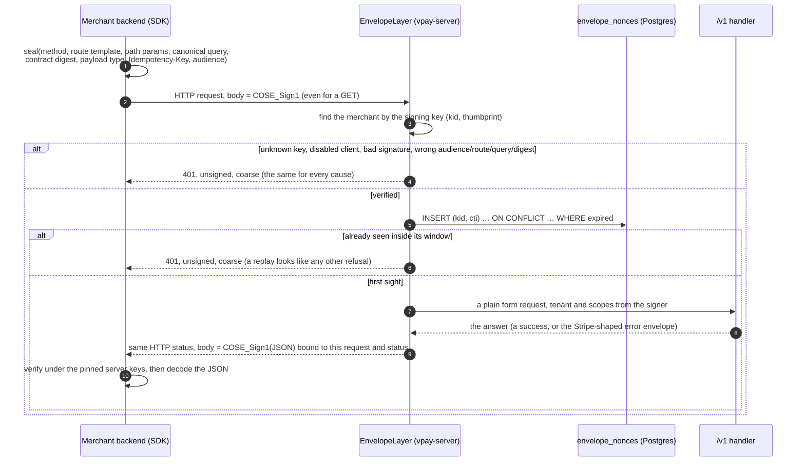
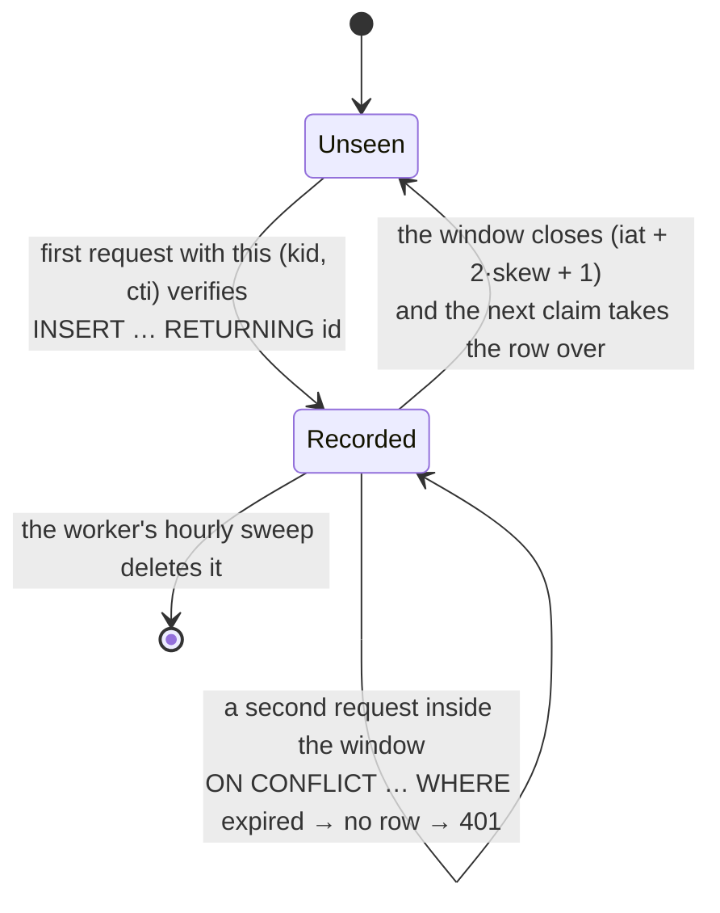
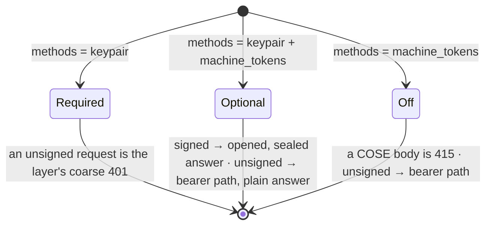
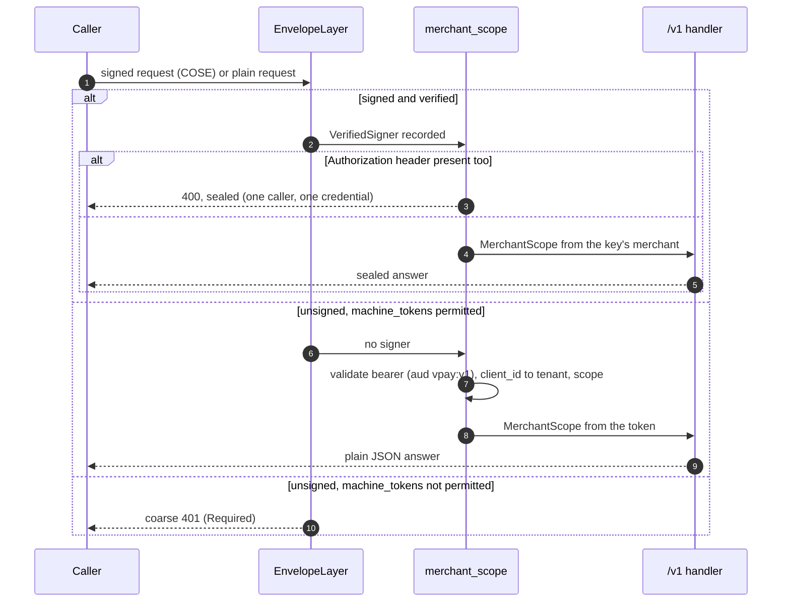

# The signed `/v1` transport

> **Since ADR-0037 (VPA-1) the invariant below holds for a deployment that
> permits `keypair` alone, which is how vaam runs.** `auth.methods` chooses
> which ways in `/v1` has; see ["Both ways, when the deployment permits it"](#both-ways-when-the-deployment-permits-it).
> A config that does not name the key permits every method, so a bearer token
> is accepted beside a signature unless the operator turns `machine_tokens`
> off.

## The invariant

> **No `/v1` request is handled unless it is a COSE_Sign1 message signed by a
> key the operator registered for a merchant, addressed to this deployment, and
> seen for the first time. Every answer to such a request is a COSE_Sign1
> message signed by this deployment, and a client that does not recognise the
> signing key does not read it.**

There is no access token, no refresh token, no `client_credentials` grant and
no API key on `/v1`. A merchant's identity on the wire is an Ed25519 key
(`merchant_clients[].cose_keys`), and vpay's is one of two Ed25519 response keys
(`VPAY_ENVELOPE_SIGNING_KEY_FILE`, `..._NEXT_FILE`) that every client pins.
[ADR-0035](../adr/0035-v1-is-a-signed-message-not-a-token.md) records the
decision and what it supersedes; this page is the mechanism.

It is cratestack's signed transport (`cratestack-axum`'s `EnvelopeLayer`,
`cratestack-client-rust`'s `ClientEnvelope`, `cratestack-cose`), not a design of
vpay's. vpay chooses what is bound, which keys are trusted and where the replay
cache lives.

## One call

## What a signature binds

A request signature covers, byte for byte, all of: the **audience** (the
deployment's `deployment.public_base_url`), the **method**, the **route
template** (`/payment_intents/{id}/confirm`), the **path parameters** as
matched, the **canonical query** (pairs sorted, so `?b=1&a=2` and `?a=2&b=1`
are one request), the **contract digest** of the operation, the **payload
type** (`application/x-www-form-urlencoded` in, `application/json` out), the
**`Idempotency-Key`** as sent, and the payload. A request therefore cannot be
re-addressed to another deployment, another route, another resource, another
query or another idempotency key without the signature failing.

The contract digest is `SHA-256(domain || "rest" 0x00 || METHOD 0x00 || template)`
over the operation's identity, from `vpay-wire`'s table of 37 operations
([reference](../reference/vpay-wire.md)). Both SDKs carry a vendored copy of the
table; a workspace test fails if either copy, or the digest derivation, or the
way a concrete path is matched to a row, drifts from `vpay-wire`'s
([parity](../sdks/parity.md)).

An answer's signature covers the **request it answers** (the digest of the
request's COSE bytes), the **status**, the payload type, and the
`Idempotency-Key`. A sealed `404` cannot be replayed as the answer to another
request, and a sealed `200` cannot be delivered with a `500` status.

`Authorization`, `Stripe-Version`, `User-Agent` and every other header are not
bound and not read. The layer sits in front of everything that could read one.

## Where the keys come from

| Key                            | Where it is configured                                                                                                | Who holds the private half    | Who pins the public half |
| ------------------------------ | --------------------------------------------------------------------------------------------------------------------- | ----------------------------- | ------------------------ |
| A merchant's signing key       | `merchant_clients[].cose_keys` (public, unpadded base64url; one or more, optionally labelled)                         | the merchant only             | vpay                     |
| vpay's response key, `current` | `VPAY_ENVELOPE_SIGNING_KEY_FILE` / `--envelope-signing-key-file` (a file with the seed: 32 bytes, unpadded base64url) | vpay (server Deployment only) | every client             |
| vpay's response key, `next`    | `VPAY_ENVELOPE_SIGNING_KEY_NEXT_FILE` / `--envelope-signing-key-next-file`                                            | vpay                          | every client             |

`vpay-server` logs both public response keys at boot, and refuses to start (exit 78) if either file is missing or malformed, if the two are identical, or if the
merchant key registry cannot be built. `cargo xtask gen-envelope-key --out <dir>
--name <stem>` writes `<stem>.seed` and `<stem>.pub`; the compose stacks use
throwaway ones from `just gen-envelope-keys`, and the Helm chart takes them from
a Secret ([`envelopeKeys`](../../deploy/helm/vpay/README.md)).

### Rotation

- **vpay's response key.** Publish `next`'s public half to merchants first (they
  pin `{current, next}`); once they have it, swap the two seeds and generate a
  new `next`. An answer sealed by either pinned key verifies, so the swap is not
  a flag day. A client that never learned `next` refuses the first answer after
  the swap (`unverified`), which is the failure the order above avoids.
- **A merchant's key.** `cose_keys` is a list: register the new public key
  beside the old, move the merchant's backends over, then remove the old one in
  a config change. A key that is removed stops authenticating on the next
  deploy; an urgent revocation is a `disabled_clients` row for the whole
  client, which takes effect on the next request with no restart.

## What a refusal looks like

Every cause of a refusal before the handler is the layer's one coarse `401`:
**unsigned, identical bytes, nothing about why**. That is deliberate (a refusal
that varied with its cause would be an oracle), and it is the price the
operator pays at diagnosis time:

| Cause                                  | Check                                                                                                     |
| -------------------------------------- | --------------------------------------------------------------------------------------------------------- |
| The key is not registered              | `cose_keys` holds the **public half of the seed the merchant signs with** (`signing.pub` beside the seed) |
| The client is disabled                 | a row in `disabled_clients` (`vpay_db::disable_client`)                                                   |
| The audience differs                   | the client's `audience` (the SDK default is `baseUrl`) is `deployment.public_base_url`, byte for byte     |
| The message was replayed               | a retrying proxy re-sending the same bytes; the SDKs seal a fresh message per attempt and never retry     |
| The clock is more than 300 s off       | the merchant host's clock against vpay's                                                                  |
| The path or method is not an operation | `vpay-wire`'s table; an unknown `/v1` path is the honest `404`, not a `401`                               |

The SDKs turn an unsigned answer into `Error::Unsigned` / `VpayUnsignedResponseError`
and an answer that does not verify under the pinned keys into `Error::Unverified`
/ `VpayUnverifiedResponseError`. **The unsigned answer is no longer the Stripe
error envelope** the bearer middleware used to render: it is `{"code":
"UNAUTHORIZED", …}` as JSON when the caller asked for JSON and the same document
as CBOR when it asked for the envelope's type. Errors raised **after** the layer
(validation, `404`, `409`, `403` for a missing scope) are still the Stripe-shaped
envelope, sealed.

The two routes that stay outside it: `/livez`, `/metrics` (observability port)
and `/healthz`, `/readyz` on the traffic port; and the surfaces that are not the
merchant's: `/v1/browser/*` (a payer's browser, a publishable key and a
`client_secret`), `/dash/v1/*` (staff), `/provider/*` (rail callbacks) and the
`/v1/oauth/*` OP, which stays until VP-4.

## The replay cache

`envelope_nonces(id TEXT PRIMARY KEY, expires_at TIMESTAMPTZ)`
(migration `0055`), one row per accepted `(kid, cti)`:

The claim is one statement, so two replicas opening the same captured request
at the same instant are serialised by the row lock: one gets the row, the other
none. The comparison reads the database's clock (ADR-0026). The sweep
(the worker's `SweepExpired` job) deletes rows expired for more than five
minutes (`ENVELOPE_NONCE_RETENTION`).

## Both ways, when the deployment permits it

[ADR-0037](../adr/0037-authentication-methods-are-deployment-configuration.md)
makes the mode of `/v1`'s envelope a function of `auth.methods`
([vpay-config.md](../reference/vpay-config.md#auth--which-ways-of-authenticating-a-deployment-permits-adr-0037)):

- Under `Optional` the policy is a closure with the unresolved mode pinned to
  `Required`, so a route the resolver cannot bind still fails closed and a
  method the table does not serve is still the layer's own `405`.
- **A signed request that fails to verify is the `401`, never downgraded** to the
  bearer path, whatever it also carries.
- A token caller's refusals are the Stripe-shaped plain ones the bearer
  middleware gave before VP-3 (`missing_bearer_token`, `invalid_token`, `503`
  when the JWKS cannot be read, `403` for a genuine token naming no registered
  client or lacking the scope the method needs).
- **A token caller is not protected the way a sealed one is**: answers are not
  sealed (not even when the request asks for a sealed one with
  `Cratestack-Nonce` and `Accept: application/cose`: the response seal policy is
  "never" under `Optional`) and requests are not bound to a contract (the `426`
  for an operation whose shape is gone does not reach them). It is **not** a
  separate tenant of the replay protections: idempotency is keyed on
  `(merchant_id, Idempotency-Key)`, so the same key from a signed and from a token
  request of one merchant is one key, and no `/v1` handler keys a rate limit on
  the credential. `disable_client` reaches a token caller on its next request, as
  it reaches a signer (`401` `invalid_token`). The span of every `/v1` request
  carries `auth.method = keypair | machine_token`.
- **A signed request that also carries `Authorization` is `400` on every
  deployment, `[keypair]` included.** It used to be ignored; see the upgrade note
  in [ADR-0037](../adr/0037-authentication-methods-are-deployment-configuration.md).
- `GET /.well-known/vpay-auth` tells a client which methods the deployment
  permits and serves, without a credential.

## Not in this page

- **Refund destination confirmation's second signature.** `confirmRefundDestination`
  and money intents elsewhere carry an Authorization-key signature on top of the
  envelope; that is not built here.
- **Removing the OP.** VP-4 would have deleted `/v1/oauth/*`; ADR-0037 keeps it
  for a deployment that permits `machine_tokens`. With the method off it is not
  mounted and `jwks:` in a merchant registration is refused.
- **`curl`.** A request is a COSE message, not a header on an ordinary one, so
  `curl` cannot make one. `sdks/nodejs/scripts/vpay-call.mjs` makes one signed
  call from a shell, and [`examples/merchant-curl`](../../examples/merchant-curl/)
  uses it.

## Status

**Built and proven, 2026-10-26 (VP-3, VP-5, VP-7).** The layer is mounted on
`/v1` in mode `Required`; both SDKs seal; the stripe-node adapter is a sealing
`httpClient`; the shop, the Cypress tasks and every example sign; compose and the
Helm chart take the keys from generated files and a Secret. The proof is in
[../status/backend.md](../status/backend.md) ("`/v1` is a signed message in both
directions") and [../status/merchant-sdks.md](../status/merchant-sdks.md); the
cases that matter most are `signed_transport.rs` (against a real Postgres and
the shipping router) and `vpay-db`'s five nonce cases.

**Not run where this was written, and so not yet evidence:** the compose
end-to-end stack (`just test-e2e`, the Cypress specs, the stripe-node conformance
suite and the SDKs' live suites), the Helm render and `kubeconform`, and the
workspace under Rust 1.99. CI's `e2e`, `helm` and `rust` jobs are the evidence for
those halves.
