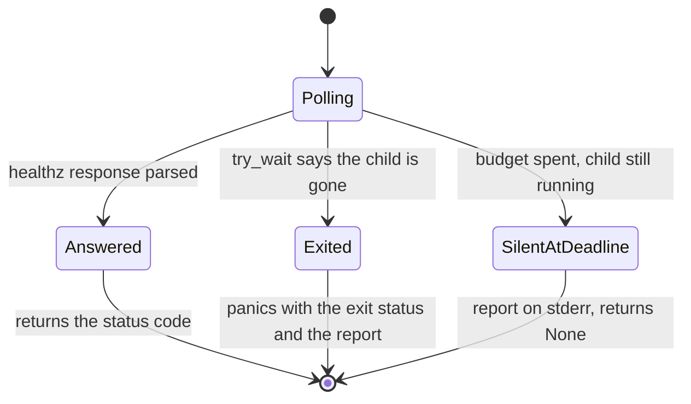

# 2026-10-21 — a `vpay-server` that fails to boot in `tests/cli.rs` now says why

Branch `claude/cli-spawn-diagnose`, stacked on `claude/heuristic-brattain-55d0a7`
(#311) at `4361e05a`; `master` was at `e28292d3`. The change is **one test file**,
`backends/apps/vpay-server/tests/cli.rs`. **No server code, no route, no gate, no
`NotImplemented` token and no existing assertion moved**; nothing is `#[ignore]`d.
The file goes from 40 tests to 43: three are new and are the regression tests for
this change.

It follows [the page for #311](2026-10-21-cli-tests-observability-port.md), which
removed one cause of `server never became healthy … left: None, right: Some(200)`
and ended on a red run of the same shape whose cause it had not captured, because
the tests sent the server's stdout and stderr to `/dev/null` and polled five
seconds for a process that might already be gone.

## What changed



- **The guard owns the server's output.** `ChildGuard` now carries a `ServerLogs`:
  every spawned server writes stdout and stderr to files in `CARGO_TARGET_TMPDIR`,
  removed with the guard. Files, not pipes — nothing reads a pipe until a test
  fails, and an unread pipe fills and stalls the server.
- **`poll_healthz` takes the guard.** Each iteration asks `Child::try_wait` first. A
  server that has exited fails the poll **at once**, naming its exit status, its
  stderr (where `main` prints `vpay-server: {error:#}`) and the last eight lines of
  its stdout. A server that is **alive but silent** returns `None` at the deadline
  exactly as before, after writing the same report to the test's stderr, which
  libtest prints only for a test that fails. All seven callers pass their guard;
  their assertions and messages are unchanged.
- **`spawn_and_capture_stdout` tees.** Its reader thread now also writes each line to
  the stdout log, before sending it down the channel. This was added after the
  first version, because the two tests that wait on `/healthz` through that helper
  are the ones that failed as "alive but silent", and a report that said "stdout:
  read by the test itself" could not say how far the boot had got.
- **Three tests**, all without a container:
  `a_server_that_exits_while_polled_fails_fast_and_says_why` (a config that fails
  validation exits 78 under a 30 s budget; the failure must name `exit status: 78`
  and the server's `livemode requires https` and arrive in under 10 s),
  `a_server_that_is_alive_but_silent_times_out_with_none` (an unreachable database
  holds the real binary open for 5 s; a 1 s poll must return `None` and not panic,
  with the child still running) and
  `the_report_of_a_server_read_through_a_channel_still_carries_its_stdout`.

What it prints, from the one scenario forced on purpose — a server whose traffic
port was taken by someone else, against a throwaway Postgres:

```text
vpay-server exited (exit status: 1) before it answered /healthz on 127.0.0.1:63050
--- stderr ---
vpay-server: binding 127.0.0.1:63050: Address already in use (os error 48)
--- stdout, last 8 line(s) ---
{"timestamp":"…","level":"INFO","fields":{"message":"database connected and migrations applied"},…}
…
```

## The new tests catch what they are for

Each was run against a deliberately broken helper, and the file restored byte for
byte afterwards (`diff -q` against a saved copy).

| Mutation                                             | Test that failed                                                         | Result                                                   |
| ---------------------------------------------------- | ------------------------------------------------------------------------ | -------------------------------------------------------- |
| the helper never notices an exit (the old behaviour) | `a_server_that_exits_while_polled_fails_fast_and_says_why`               | failed after 30.03 s — the whole budget, as the old code |
| the helper panics on a server that is still running  | `a_server_that_is_alive_but_silent_times_out_with_none`                  | failed in 0.06 s, `exited (None)`                        |
| the reader thread stops writing the stdout log       | `the_report_of_a_server_read_through_a_channel_still_carries_its_stdout` | failed                                                   |

## What it was used for: the red run

The brief was to loop plain `cargo test` until the residual failure reproduced and
read its error. Every run below is the whole file, run as the binary `cargo test`
builds, so tests run on parallel threads as they do under `cargo test`; none is
nextest, which serialises the file.

| What                                                                     | Runs                       | Result                                                            |
| ------------------------------------------------------------------------ | -------------------------- | ----------------------------------------------------------------- |
| helper without the stdout tee: one binary at a time                      | 40                         | **42 passed**, 0 failed, 0 ignored, every run                     |
| the same, two binaries at once                                           | 15 iterations, 30 binaries | **42 passed**, 0 failed, 0 ignored, every binary                  |
| **boot-time sample**, one binary at a time, with a temporary timing line | 25                         | 24 green; **1 red**, below                                        |
| the free-then-bind window **widened by 1.5 s** (temporary, discarded)    | 30                         | 29 green; **1 red**, below; **no port was ever stolen**           |
| final code, one binary at a time, stopped at the first failure           | 59                         | 58 green; **1 red**, which was a different flake, below           |
| final code, plain `cargo test`, first verification batch                 | 10                         | run 1 **39 passed, 4 failed**, runs 2–10 **43 passed**, 0 ignored |
| final code, nextest, first verification batch                            | 2                          | both **red**, one failure each — below                            |
| final code, plain `cargo test`, second verification batch                | 12                         | **43 passed**, 0 failed, **0 ignored**, every run                 |
| final code, nextest `--no-fail-fast`, second verification batch          | 3                          | **43 passed**, 0 failed, **0 skipped**, every run                 |

**Time from spawn to `/healthz` answering**, 174 successful polls across the 25
boot-time runs: minimum 355 ms, median 634 ms, 90th percentile 754 ms, 99th 949 ms,
**maximum 978 ms**. Against a 5 s budget that is a factor of five.

The reds, by what the report (or the panic) said:

1. **A server alive but silent** — in the boot-time sample,
   `shutdown_grace_period_flag_still_allows_a_prompt_clean_exit_with_no_in_flight_work`,
   `still running but never answered /healthz … within 5s`, in a run whose other
   boots all took under a second. It was not an exit. Its stdout was not logged yet
   (it reads through the channel), which is the gap the tee closes.
2. **Alive but silent, two tests at once, in the widened window.** For one of them
   stdout was logged, and it shows where the five seconds went:

   ```text
   11:31:17.525  OAuth signing key loaded
   11:31:21.818  database connected and migrations applied
   ```

   4.3 s for the database connect and migrations, against about 0.2 s in a normal
   boot, and nothing further had been logged when the poll gave up. The server was
   running the whole time.

3. **A server that exited 69 with Postgres's answer in its mouth** — nextest, first
   verification batch, `an_in_flight_request_that_outlasts_the_grace_period_is_exit_1_and_says_so`,
   the new report arriving 1.4 s in:

   ```text
   vpay-server exited (exit status: 69) before it answered /healthz on 127.0.0.1:65123
   --- stderr ---
   vpay-server: connecting to Postgres: failed to connect to Postgres: encountered unexpected or invalid data: unexpected response from SSLRequest: 0x00
   ```

   The port was mapped and accepted the connection, and the first byte back was
   `0x00`, not `S` or `N`: not (yet) a Postgres. Before this change that run would
   have said `None` after five seconds.

4. **`PortNotExposed { port: Tcp(5432) }`**, panicking at `cli.rs:49` inside
   `start_postgres` before any server was spawned: run 59 of the final-code loop
   (one test), run 1 of the first verification batch (four tests at once) and nextest
   run 2 of that batch (one test). It is the testcontainers port-map flake
   [2026-09-18](2026-09-18-macos-loopback-and-two-load-flakes.md) § 4 names and left
   standing, which `.config/nextest.toml`'s `postgres-containers` group exists to keep
   away — and which it did not, on this machine, in this batch.

**What the reds have in common** is the thing they do _not_ have: none was a server
that lost a bind, and none was a server that lost its port. After #311, every red
that could be read had its cause in the path to Postgres — the container's port
map, or the server's own database connect. That is one family seen at three stages,
**not shown to be one cause**: nothing here isolates what Docker Desktop was doing
when it happened, and the second verification batch, run immediately afterwards
with nothing else on the machine, was 15 for 15.

### What that says about the candidate

[#311's page](2026-10-21-cli-tests-observability-port.md) named one unproven
candidate for the residual failure: the traffic port, freed by `free_addr` and
taken by something else before the server binds it, so the server exits 1 on
`binding 127.0.0.1:PORT`. **Measured, it is not supported.** With the window
widened by 1.5 s for every test, in 30 whole-file runs, no server ever lost its
traffic port — no `binding …: Address already in use` — and the one failing run
was a server still running. The window as it stands is short too: in the one boot
measured for this, the first boot log line to the last one before the bind was
about a quarter of a second.

What was observed instead is a server **alive but silent for the whole budget**,
once naturally, and again, with evidence, when the window was widened. That is
a boot that takes more than five seconds, and the one stage seen taking the time
was the database connect and migrations. **What slowed it was not isolated:** the
loop with all twelve cores saturated by `yes` did not reproduce it (see #311's
page), so it is not plain CPU starvation; Docker Desktop's Postgres container
under twelve simultaneous starts is the suspect, and nothing here tests it.

So the larger change the brief held in reserve — the server binds `:0` and the test
reads the port back from the `listening addr=` log line — **was not made**: its
premise did not hold.

## What was not done, and the one decision left

- **`poll_healthz`'s 5 s budget is unchanged.** The data above is the case for
  raising it, and it is a case, not a proof: normal boots finish in under a second
  (174 samples), and a boot slower than five seconds happened once in 25 ordinary
  runs and, in the widened experiment, in two tests at once, which was one event.
  The worker tests in this
  file already wait 20 s (`wait_for_line`). With the exit now detected immediately,
  a larger budget costs a dead server nothing and costs only a server that is alive
  and genuinely stuck the difference. It is a one-constant change across seven call
  sites, and it is left for a reviewer because this page's brief was diagnosability,
  and because the cause of the slow boot is not known — a larger budget would hide
  it from the next person rather than explain it.
- **The residual red run is still not fully explained.** "Alive but silent for five
  seconds" is now the observed shape; "the database connect and migrations took 4.3
  s" is one observed instance of it; whether every instance is that is not shown.
- **Nothing here runs on Linux**, and CI's nextest cannot see any of it.
- **`just ci` as a whole** was not run; see below for what was.

## Gates

On the final tree, which has the same Rust as every run counted as "final code"
above (checked by `diff` against the saved copy before the batches):

- `just verify`: **all fifteen gates passed**, exit 0, on the tree after the last merge
  below (`verify-doc-counts` 13 counts agree, with the directory at 92 files and the
  index naming 69; `verify-links` figures are in the merge note).
- Both clean: `cargo fmt --all -- --check`, and
  `cargo clippy -p vpay-server --all-targets -- -D warnings`.
- Plain `cargo test -p vpay-server --test cli`, **twelve in a row**, second batch:
  **43 passed, 0 failed, 0 ignored** each (12.13 s – 13.88 s). In the first batch,
  runs 2–10 were also green, nine in a row, after a run 1 whose four failures were
  all `PortNotExposed`.
- `cargo nextest run -p vpay-server --test cli --no-fail-fast`, three runs:
  **43 passed, 0 skipped** each (63.1 s – 64.3 s). Its first two runs, in the first
  batch, were red, as listed above.
- `prettier@3.9.6 --check` on the three changed Markdown files: clean.
  `markdownlint-cli2@0.20.0` with super-linter's default config: 0 errors on all
  three, with a deliberately misaligned table linted in the same invocation to show
  the tool ran (it reported 3).
- The page's one diagram was rendered in a browser and looked at.

**Merged with `master` after #311 and #318 landed.** #311 was squash-merged, so this
branch's history carried its original commits and conflicted in three files. Two,
`tests/cli.rs` and #311's page, were byte-identical on `master` to #311's last commit,
so this branch's version, which is that plus this change, was taken whole. The third,
`docs/status/README.md`, was rebuilt from `master`'s with this page's entry added:
`master` said 87 files and 64 named over a directory of 89 and an index of 66, and its
history sentence named neither #311's page nor #318's, so the counts here are 90 and
67 and the history sentence says so. The pull request was retargeted
from #311's branch to `master`, whose diff is now these four files.

`master` moved again before this was reviewed (#314), and the index had been made
consistent there at 91 files and 68 entries, so a second merge conflicted in the same
file alone. It was resolved by keeping `master`'s entries and sentence as they stood
and adding this page's entry at the head, which makes the counts 92 and 69.

On the merged tree: `just verify` passed (above); plain `cargo test -p vpay-server
--test cli` five times, **43 passed, 0 failed, 0 ignored** each (12.37 s – 14.81 s);
`cargo nextest run -p vpay-server --test cli --no-fail-fast`, **43 passed, 0 skipped**
(64.4 s); and `cargo fmt --all -- --check` and clippy on the package clean.

**Not run:** `just ci` as a whole (the workspace's `test-rust` and `test-doc`,
`verify-ignored`, `lint-web`, `test-web`, `audit-web` and `deny`), which CI runs;
only `vpay-server`'s `tests/cli.rs` was, because it is the only file whose behaviour
changed. Nothing ran on Linux. No companion `vpay-skills` PR: no gate, route,
`NotImplemented` token, toolchain pin or cited path moved (`AGENTS.md` § "Docs↔skills
parity").
