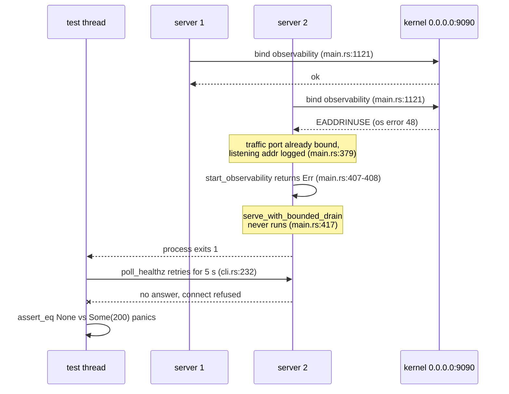
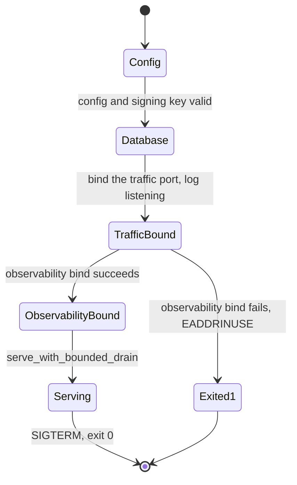

# 2026-10-21 — `vpay-server`'s `tests/cli.rs` lost a race for port 9090 under plain `cargo test`

Branch `claude/heuristic-brattain-55d0a7`, from `master` at `4ca1fed0` (#308),
where everything under "Before" was measured. The change is **one function in
one test file**, `bin()` in `backends/apps/vpay-server/tests/cli.rs`. **No
server code, no route, no gate, no `NotImplemented` token and no assertion
moved**, and nothing is `#[ignore]`d: the file is 40 tests before and after.

The failure was reported from a maintainer's MacBook while verifying a
docs-only branch (#310): `cargo test -p vpay-server --test cli` gave `39
passed, 1 failed` twice, on `an_explicit_flag_wins_over_a_conflicting_env_var`,
with `left: None, right: Some(200)` — "the --bind address never came up". The
same test passed alone, the file passed with `--test-threads=1`, and `cargo
nextest run` (which `just test-rust` and CI use) passed. That pattern is what a
test that is not independent of its neighbours looks like, and this page is the
measurement of which neighbour.

## Before — `master` fails too

`cargo test -p vpay-server --test cli`, then `cargo nextest run -p vpay-server
--test cli`, on a fresh worktree of `master` at `4ca1fed0`, macOS, Docker
Desktop 4.92.0, 12 logical cores. Nothing was running on port 9090 beforehand.

| Runner          | Run | Result                           | Ignored / skipped |
| --------------- | --- | -------------------------------- | ----------------- |
| `cargo test`    | 1   | **40 passed**, 0 failed, 12.71 s | 0                 |
| `cargo test`    | 2   | **40 passed**, 0 failed, 12.06 s | 0                 |
| `cargo test`    | 3   | **39 passed, 1 failed**, 12.08 s | 0                 |
| `cargo nextest` | 1   | **40 passed**, 0 failed, 62.5 s  | 0 skipped         |
| `cargo nextest` | 2   | **40 passed**, 0 failed, 62.7 s  | 0 skipped         |

The failure in run 3 was a **different test** from the reported one —
`a_valid_config_lets_the_server_boot_and_serve_healthz`, `cli.rs:938`, `server
never became healthy on 127.0.0.1:52918 with a valid config`, `left: None,
right: Some(200)`. Same shape, different victim: the failing test is whichever
server loses, not a test with something wrong in it.

## The mechanism

Every `vpay-server` boot path — `serve` and `worker` alike — binds a second,
observability listener, **last**, and its default is the fixed
`0.0.0.0:9090` (`vpay-config/src/cli.rs:176`). Of the 40 tests, 14 start a
server far enough to reach that bind (the 14 that call `with_live_postgres` and
are not `staff add`, which opens no listener). **Three** of them set
`VPAY_OBSERVABILITY_BIND` — `the_observability_listener_serves_livez_and_metrics_on_its_own_port_only`,
`an_in_flight_request_that_outlasts_the_grace_period_is_exit_1_and_says_so` and
`the_worker_serves_livez_and_metrics_on_the_observability_port`. The other
**eleven** take the default: in `serve` mode
`a_valid_config_lets_the_server_boot_and_serve_healthz`,
`a_server_with_no_os_trust_store_boots_and_still_validates_tokens`,
`bind_and_log_format_env_vars_are_actually_applied`,
`an_explicit_flag_wins_over_a_conflicting_env_var`,
`shutdown_grace_period_flag_still_allows_a_prompt_clean_exit_with_no_in_flight_work`
and `sigterm_immediately_after_startup_still_triggers_graceful_shutdown` (twenty
spawns of its own); in `worker` mode
`a_worker_concurrency_at_the_pools_ceiling_boots_and_logs_that_concurrency`,
`a_valid_config_lets_the_worker_boot`,
`profile_env_var_is_read_and_stamped_into_the_startup_log`,
`an_explicit_profile_flag_wins_over_a_conflicting_env_var` and the worker's own
`sigterm_immediately_after_startup_still_triggers_graceful_shutdown`. Cargo runs
a test binary's tests on parallel threads; two of those servers alive in the
same second, or any other process holding 9090, and the later one loses the
bind.





`TrafficBound -> Serving` is the edge that does not exist. `/healthz` is
answered by `serve_with_bounded_drain`, and `start_observability` sits between
the traffic bind and that call — which is deliberate (`/livez` answering means
booting finished, `main.rs:1087`), and why a lost race looks like a server that
**logged that it was listening** and then never answered.

**Why every other way of running it passes.** Alone, one server holds 9090 at a
time. With `--test-threads=1`, the same. Under `cargo nextest`, `.config/nextest.toml`
puts `package(vpay-server)` in the `postgres-containers` group with `max-threads
= 1`, so the file runs one test at a time — a serialisation that exists to keep
container starts apart and was hiding this as a side effect. The window is
narrow because a server is alive for a second or two and most tests do not
overlap: 1 whole-file run of 3 here, 2 of 2 on the reporter's machine.

**A test run in another checkout is the same fault.** Nothing about 9090 is
per-process: two worktrees running `cargo test -p vpay-server` at once collide
even under nextest, because the group's `max-threads` bounds one invocation
only. That is why "After" includes two test binaries running at the same time.
It was not run on the unfixed binary — the overwritten build is gone — so it
shows the fixed one survives a concurrent neighbour, not that the unfixed one
fails.

## The cause, proven rather than inferred

1. **Control** — nothing on 9090, `a_valid_config_lets_the_server_boot_and_serve_healthz`
   run alone from the built test binary: `1 passed`, 2.01 s.
2. **Repro** — the same command with a Python socket holding `0.0.0.0:9090`:
   `FAILED` after 6.38 s (5 s of polling plus a boot), with the identical
   panic — `left: None, right: Some(200)`, "server never became healthy on
   127.0.0.1:55042".
3. **The server's own words**, which the tests discard (`Stdio::null()`): two
   real `vpay-server` processes started by hand against one throwaway
   `postgres:16-alpine`, same environment, first on `--bind 127.0.0.1:18401`, the
   second on `:18402`. The second logged `listening addr=127.0.0.1:18402`, then
   printed

   ```text
   vpay-server: binding the observability listener on 0.0.0.0:9090 (--observability-bind / VPAY_OBSERVABILITY_BIND): Address already in use (os error 48)
   ```

   and exited **1**. `curl http://127.0.0.1:18402/healthz` afterwards: connection
   refused.

The throwaway database was stopped afterwards; nothing it held was kept.

## The fix, and what it is not

`bin()` — the one place the test file builds a `vpay-server` command — now sets
`VPAY_OBSERVABILITY_BIND=127.0.0.1:0` before returning it. Port `0` cannot
collide: the kernel hands each server its own, and `start_observability` logs
the bound address (`main.rs:1135`), which is exactly why `CommonArgs`'s doc
comment already says "a `:0` port is a real configuration — the subprocess tests
use it". They did not; now they do. The two tests that read the observability
listener set `VPAY_OBSERVABILITY_BIND` themselves, **after** `bin()`, and
`Command::env` is last-writer-wins, so they are unchanged.

Not done, and why:

- **No server change.** The default `0.0.0.0:9090` is the chart's contract
  (`observability.port`, the `metrics` container port); the server failing
  loudly when it cannot bind is correct and is the reason this was findable.
- **`poll_healthz`'s 5 s budget is unchanged.** It was not the cause of the 9090
  failures: those were exits, and a larger budget would only have made them
  take longer. Whether it matters for the red run is not known.
- **`two_free_addrs` / `free_addr` are unchanged.** They free the port before
  the server binds it, so a window exists in which another test's server could
  take it. That is a different, much smaller race, never observed in any run
  here, and a fix needs the server to report its own bound port. Named, not
  measured.
- **No test was added for "nothing in this file depends on 9090".** The only
  honest version holds 9090 itself, which would collide with the thing it is
  guarding. The check is the held-port run below.

## After

All on the fixed file, same machine, same Docker, test binary run from the
build the runner made.

| What                                                   | Result                                                            | Ignored / skipped |
| ------------------------------------------------------ | ----------------------------------------------------------------- | ----------------- |
| Whole file, `0.0.0.0:9090` held by another process     | **40 passed**, 0 failed, 12.14 s                                  | 0                 |
| `cargo test`, first batch, runs 1–4                    | **40 passed**, 0 failed each (26.95 s, 27.08 s, 12.59 s, 17.89 s) | 0                 |
| `cargo test`, first batch, run 5                       | **39 passed, 1 failed** — see "The red run" below                 | 0                 |
| Two test binaries at once, three times (six binaries)  | **40 passed**, 0 failed, all six                                  | 0                 |
| `cargo nextest`, twice                                 | **40 passed**, 0 failed, 62.2 s and 72.5 s                        | 0 skipped         |
| `cargo test`, **ten in a row**, final batch, runs 1–10 | **40 passed**, 0 failed each (11.92 s – 29.49 s)                  | 0                 |
| `cargo nextest`, twice, final batch                    | **40 passed**, 0 failed, 74.5 s and 62.7 s                        | 0 skipped         |

Held-port row: the test binary run directly while a Python socket held
`0.0.0.0:9090` — the condition that failed one test in the repro above. Before
the change that was measured for one test; the whole file was not run against
it unfixed.

The final-batch `cargo test` runs 6–10 took 19.7–29.5 s against 12 s for 1–5,
because the machine was busy with unrelated work, including diagram rendering
for this page. They are in the table because they passed under that load, not
despite it.

### The red run

**One run in the first batch failed after the fix, and its cause is not known.**
`a_valid_config_lets_the_server_boot_and_serve_healthz`, `cli.rs:954` as the file
now numbers it, `server never became healthy on 127.0.0.1:59844 with a valid
config`, `left: None, right: Some(200)` — the same test and the same panic as the
failure on `master`, so the symptom did not change. What did change is that this
one cannot have been 9090: after the fix no server in the file binds it.

To catch it, `Stdio::null()` was replaced, on a throwaway copy of the file
that was restored byte-for-byte afterwards (`git diff` shows only `bin()`), with a
per-spawn log file for every spawned server's stdout and stderr, and the whole
file was run in a loop that stops on the first failure and keeps the logs.
**55 runs, none failed:** 25 on an idle machine and 30 with twelve `yes`
processes saturating all twelve cores, which is evidence against a boot that
merely outran the 5 s budget, not a proof that none can. The twelve processes
were confirmed gone afterwards.

So `master` failed 1 whole-file run of 3 here (and 2 of 2 on the reporter's
machine), and the fixed file has failed 1 of 70 (1 red of 15 uninstrumented, 0
of 55 instrumented). Both samples are small, and the gap between them is the
evidence the 9090 collision was most of the problem, not a measurement of how
much. What remains is **a failure of the same shape that is much rarer and
whose cause was not captured.** The candidate, unproven, is the race this
change does not touch: `two_free_addrs` / `free_addr` drop their listeners and
the server binds the port only after its config, database, migrations and key
(`main.rs:301`, `boot`, then the bind at `main.rs:307`), so something else on a
busy host, another
checkout's server included, can take the port in between, and the server then
exits 1 on `binding 127.0.0.1:PORT`. If that is it, it is the same test lost to
a second race, and the fix is for the server to bind `:0` and the test to read
the port back from the `listening addr=` line, which is a larger change than
this one and was left for that reason.

**Corrected later the same day, by
[2026-10-21-cli-spawn-diagnostics.md](2026-10-21-cli-spawn-diagnostics.md).** Two
things in this section did not survive measurement. The candidate above was
tested by widening the free-then-bind window by 1.5 s for every test: in 30 runs
no server lost its traffic port. And "evidence against a boot that merely outran
the 5 s budget" is withdrawn: a server **alive but silent for the whole budget**
occurred once in 25 ordinary runs and, with the window widened, in two tests at
once, one with its stdout showing 4.3 s spent on the database connect and
migrations. The saturated-CPU loop above did not reproduce it, so what slows the
boot was not isolated — but a slow boot is the observed shape, and the stolen
port is not.

## On the merged tree, and the gates

`master` moved while this was being written: #310 (`e28292d3`) merged, and it
changes `vpay-server`'s `main.rs` (a log string) and `compose.yml`. It was
merged in, with one conflict, in `docs/status/README.md`'s index and counts
alone — the same file as every merge on this page's neighbours — resolved by
keeping both entries, newest first, and recounting: **86** files, **63** named.
On the merged tree:

- `just verify`: **all fifteen gates passed**, exit 0 (`verify-links` 2491 links
  in 467 files; `verify-doc-counts` 13 counts agree). `check-schema` warned that
  the CrateStack CLI on `PATH` is 0.15.1 against the 0.15.0 pin and ran in full
  against the newer grammar; that is this machine, not the change.
- `cargo test -p vpay-server --test cli`, five in a row: **40 passed**, 0 failed,
  **0 ignored** each (11.77 s – 13.26 s).
- `cargo nextest run -p vpay-server --test cli`: **40 passed, 0 skipped**, 62.0 s.
- Before the merge, which touched no Rust file of this branch, both clean:
  `cargo fmt --all -- --check`, and
  `cargo clippy -p vpay-server --all-targets -- -D warnings`.
- `prettier@3.9.6 --check` on both changed Markdown files: clean.
  `markdownlint-cli2@0.20.0` with super-linter's default config: 0 errors on
  both, with a deliberately misaligned table linted in the same invocation to
  show the tool ran (it reported 3).

## Not run

- **`just ci` as a whole.** The workspace `test-rust` and `test-doc`,
  `verify-ignored`, `lint-web`, `test-web`, `audit-web` and `deny` were not run;
  CI runs them. Only `vpay-server`'s `tests/cli.rs` was run, because it is the
  only file whose behaviour changed.
- **Linux.** Everything above is one macOS machine. CI's `cargo nextest` is
  serialised on that file by `.config/nextest.toml`, so CI could not see this.
- **The unfixed file under two concurrent binaries, and the unfixed file against
  a held 9090 for more than one test.** Named under "After".
- **The red run's cause.** See "The red run".
- **`vpay-skills`.** No gate, route, `NotImplemented` token, toolchain pin or
  cited path moved, so no companion PR (`AGENTS.md` § "Docs↔skills parity").
