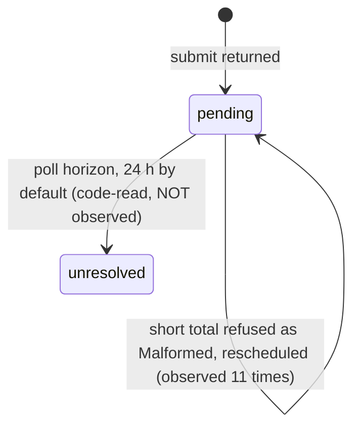

# 2026-10-21 — Notch Pay's sandbox through vpay itself: RFC-0012 step 5

## What this is, and what it is not

This is delivery step 5 of [RFC-0012](../../rfc/0012-notchpay-adapter.md)
(epic [#291](https://github.com/vaam-apps/vpay/issues/291)): the first
test-mode payments through `vpay-server`, its worker and Postgres, by way of
the `notchpay` adapter's `submit` and `query_status`, against Notch Pay's real
sandbox. Three payments were made, and what became of each is read below from
Postgres and from the worker's log.

Step 1 could not do this. [Its run](2026-10-21-notchpay-sandbox-run.md) used a
probe that built every call from `vpay-notchpay`'s wire types, and nothing in
it went through the server, the worker or the adapter. That is why
[providers.md](../providers.md) could not call the `notchpay` Collect and
Status read cells "proven" on its strength. This page is the evidence for
moving them; § "What this proves" says which cells and why.

**It is not** production, and no live key was used. It is not a refund
(`notchpay::refund` is still a `NotImplemented` token). It is not a webhook
test: runbook A4 was not run, so RFC-0012 § 10 items 7 and 17 stay open. And
it is not [RFC-0014](../../rfc/0014-verifying-rail-callbacks.md), which is
designed and not built.

## How it was run

- **Who approved it.** The maintainer, in the running session's own chat:
  "Yes, send them". The question was asked once, before any request was sent,
  and named the three numbers, the amounts and every call: initialize,
  process, and the worker's reads at 10, 20, 30, 45, 60 and 90 s and then
  every 120 s (about twenty reads), with no webhook endpoint created. Nothing
  was sent to Notch Pay before that answer.
- **From where.** The maintainer's own MacBook (macOS 27.0.1, Darwin arm64),
  in a Claude Code desktop session. **Not a cloud session**, and so no
  `--ca-bundle` anywhere: vpay has none and never gains one (ADR-0003).
- **Tree.** Branch `docs/notchpay-step5`, cut from `master` at `865420b`
  (`865420ba52af1efadcbac6793b3a05d7d97d78ab`). That contains #304 (`5b4c583`,
  payments addressed by Notch Pay's `trx.…` reference), #306 (`1ffd148`) and
  the v0.9.1 release commit `c9c2f69`. The binary was
  `cargo build -p vpay-server` (dev profile), rustc 1.98.0. Postgres was
  `postgres:16-alpine` in Docker on `localhost:5434` (runbook B0).
- **Keys.** `NOTCHPAY_TEST_PUBLIC_KEY` and `NOTCHPAY_TEST_PRIVATE_KEY` from
  `~/.config/vpay/notchpay-sandbox.env`, outside the repository. They were
  checked by property only and never printed: each contains a test marker
  (`test.` or `test_`), neither contains `live`, they differ, the public one
  starts `pk` and the private one `sk`. The env file was mode 644; the
  session set it to the runbook's 600.
- **When.** 2026-10-21. The server booted at 08:56:16Z and the worker at
  08:56:32Z. The three payments were created between 08:57:37Z and 08:57:46Z.
  The last state was read at 09:13:00Z, and both processes were stopped at
  09:13:22Z.
- **Mode.** `deployment.livemode` stayed `false`: the server's boot line says
  `livemode=false`.

## Egress

Ground rule 3 of the
[runbook](../../runbooks/notchpay-sandbox-test.md) asks for a check before
anything else, because vpay trusts only its vendored root certificates and
ignores proxy variables, so behind a TLS-intercepting proxy every call fails
at the handshake. The runbook's command:

```bash
echo | openssl s_client -connect api.notchpay.co:443 -servername api.notchpay.co 2>/dev/null \
  | openssl x509 -noout -issuer
```

The recorded output (the runbook's command prints the issuer; the record
holds the certificate's subject too):

```text
issuer=C=US, O=Let's Encrypt, CN=YR1
subject=CN=api.notchpay.co
```

The certificate for `api.notchpay.co` was issued by Let's Encrypt `YR1`, which
chains to ISRG `Root YR`, cross-signed by `ISRG Root X1`.
`Verify return code: 0 (ok)`, over TLSv1.3. No proxy variables were set.
**The issuer is a public CA**, which is what the rule asks for.

## Boot (B1, B2)

The server's boot lines, all 15 of them, with the colour codes stripped. They
are long, and they are printed whole because line 13 is the reason this
section exists:

```text
2026-10-21T08:56:16.332420Z  INFO vpay_server: provider adapters linked rails=["mtn_momo", "orange_money", "notchpay"]
2026-10-21T08:56:16.334550Z  INFO vpay_api::v1::boot: deployment profile (selects a config file only) profile=notchpay-sandbox
2026-10-21T08:56:16.339148Z  INFO vpay_api::v1::boot: configuration loaded and validated deployment=vpay-notchpay-sandbox livemode=false providers=1 merchant_clients=1 dashboard_client_configured=true
2026-10-21T08:56:16.339534Z  WARN vpay_api::v1::boot: rail notchpay is admitted under ADR-0031: its status read is authenticated by credentials.public_key, a key the provider calls public. Anyone who holds that key can: read the status, amount and customer of any payment on the account; initialize a payment on the account; process a pending payment to any phone number (a USSD prompt in the merchant's name); cancel any pending payment. In production this is the merchant's accepted exposure, and a livemode boot refuses this rail until its settings acknowledge it; see docs/flows/adapter-notchpay.md ("Production risks"). rail=notchpay livemode=false credential="public_key" document="docs/flows/adapter-notchpay.md"
2026-10-21T08:56:16.343949Z  INFO vpay_server: OAuth signing key loaded kid="ZxFaXjhsDmF8JAx2ommrsv1ICymkWAlEqbj-IE4ySSk" issuer=http://localhost:8080/v1/oauth
2026-10-21T08:56:16.766551Z  INFO vpay_api::v1::boot: database connected and migrations applied
2026-10-21T08:56:16.803819Z  INFO vpay_api::v1::boot: reference tables reconciled from configuration currencies=2 providers=1 enabled_providers=1
2026-10-21T08:56:16.807392Z  INFO vpay_db::signing_keys: rotated the active signing key kid="ZxFaXjhsDmF8JAx2ommrsv1ICymkWAlEqbj-IE4ySSk" previous_kid="<none>" retire_previous_at=2026-10-22 8:56:16.803863 +00:00:00
2026-10-21T08:56:16.807491Z  WARN vpay_server: OAuth signing key rotated; the previous key stays publishable in /jwks.json for its overlap window kid="ZxFaXjhsDmF8JAx2ommrsv1ICymkWAlEqbj-IE4ySSk" previous_kid="<none>"
2026-10-21T08:56:16.807515Z  WARN vpay_server: a dashboard_client is registered but staff_auth is incomplete; /dash/v1 mounts its READ surface and NO staff login. Set staff_auth.password_pepper and staff_auth.totp_encryption_key to serve one (ADR-0017). A livemode deployment refuses to start in this state client_id=vpay-dashboard
2026-10-21T08:56:16.807953Z  INFO vpay_server: validating /v1 tokens against this process's own JWKS over loopback jwks_url=http://127.0.0.1:8080/v1/oauth/jwks.json public_jwks_url=http://localhost:8080/v1/oauth/jwks.json
2026-10-21T08:56:16.808187Z  INFO vpay_server: /dash/v1 is mounted as a READ-ONLY resource server bound to one merchant. Whether any grant can mint a token for it is decided by `staff_auth`; see the line `staff_login` logs. See docs/flows/dashboard-auth.md and docs/status.md client_id=vpay-dashboard merchant_id=notchpay-sandbox-merchant
2026-10-21T08:56:16.808223Z  WARN vpay_server: vpay-server implements /healthz, /v1/oauth (token, discovery, jwks), the /v1 authentication boundary, /v1/payment_intents (create, retrieve, list, confirm, cancel) and, since 2026-09-16, all five /v1 refund routes: POST /v1/refunds (create), GET /v1/refunds/{id} (retrieve), GET /v1/refunds (list), POST /v1/refunds/{id} (update) and POST /v1/refunds/{id}/cancel (cancel). All three rail adapters implement `submit` and `query_status`; over seven MTN Collections payments succeeded against MTN's real sandbox on 2026-09-15, as confirmed on 2026-10-20 by Valantine Suh, who performed the tests. NOTCH PAY HAS NEVER BEEN CALLED: `notchpay` (2026-10-20, ADR-0031) is proven against a WireMock stub only, and `notchpay::refund` answers a NotImplemented token. NO REFUND HAS EVER MOVED MONEY: `mtn_momo::refund` IS written (MTN Disbursements) but no REAL MTN Disbursements credential exists in this project — the only one anywhere is the stub the e2e/demo stack points at a WireMock container — and the product has never been called; `orange_money::refund` answers a NotImplemented token, not Unsupported, so an Orange refund fails at once and gives its reservation back; and NOTHING SETTLES A PENDING REFUND — there is no refund poll ladder, so a refund these routes create stays `pending` until an operator moves it. Every other /v1 resource answers the honest 404. See docs/status.md
2026-10-21T08:56:16.808259Z  INFO vpay_server: listening addr=127.0.0.1:8080
2026-10-21T08:56:16.808418Z  INFO vpay_server: observability listener listening (/livez, /metrics) addr=0.0.0.0:9090
```

- **Line 4 is the ADR-0031 public-key WARN** this run required (ADR-0031
  condition 4). The worker printed the same WARN at 08:56:32Z.
- **Line 13 said, and was right to say when it printed, that "NOTCH PAY HAS
  NEVER BEEN CALLED".** That sentence became false during this run, at
  08:57:38Z, when the first `submit` was sent. This same change corrects it in
  `backends/apps/vpay-server/src/main.rs`.
- Nothing in the adapter calls the rail at boot: its only request-making
  methods are `submit`, `query_status` and `refund`.
- `GET /healthz` on 8080 answered `200`. `/livez` is not on 8080, where it
  answers `404` `unknown_route`: it lives on the observability port. B2 passes
  `--observability-bind 127.0.0.1:9091`, and the worker's `/livez` there
  answered `200`.
- **B1 as written bound the server's observability listener to `0.0.0.0:9090`**
  (line 15): it passes no `--observability-bind`, so the default listens on
  every interface of the maintainer's laptop. The runbook is corrected in
  this change.

## The payments (B3)

Three payments, one per outcome number, made with the merchant-node example
(`VPAY_RAIL=notchpay`). The runbook's B3 loop never sets `VPAY_AMOUNT`, so
every payment would have been the example's default of 5000 XAF, against
ground rule 4 ("vary the numbers"). This run set it. The command as run
(zsh), from the repository root; the `echo` lines only label each call and
record its exit status, and `$S` is the session's scratch folder:

```bash
for pair in 237670000000:210 237670000002:220 237670000001:230; do n=${pair%%:*}; amt=${pair##*:}; echo "== $n amount=$amt start=$(date -u +%FT%TZ)" | tee -a $S/b3.log; VPAY_BASE_URL=http://localhost:8080 VPAY_CLIENT_ID=notchpay-sandbox-merchant \
  VPAY_PRIVATE_KEY_FILE=.e2e/notchpay-sandbox-merchant/oauth-signing-key.pem \
  VPAY_RAIL=notchpay VPAY_PAYER_MSISDN=$n VPAY_AMOUNT=$amt VPAY_ORDER="np-$n-$(date +%s)" \
    node examples/merchant-node/index.mjs 2>&1 | tee -a $S/b3.log; echo "exit ${pipestatus[1]} end=$(date -u +%FT%TZ)" | tee -a $S/b3.log; sleep 2; done
```

The example's output, verbatim, with the `==` labels:

```text
== 237670000000 amount=210 start=2026-10-21T08:57:37Z
created pi_st5qsb7nnx2xn8q5j09h585w requires_payment_method
confirmed processing
== 237670000002 amount=220 start=2026-10-21T08:57:42Z
created pi_dq08famf9d3y39shngfrd507 requires_payment_method
confirmed processing
== 237670000001 amount=230 start=2026-10-21T08:57:45Z
created pi_ehbh8kr9w552b6cscm9zajhh requires_payment_method
confirmed processing
```

All three calls exited 0, at 08:57:40Z, 08:57:43Z and 08:57:46Z.

| Number          | Documented as              | Amount  | Intent                        | Charge                        |
| --------------- | -------------------------- | ------- | ----------------------------- | ----------------------------- |
| `+237670000000` | MTN success                | 210 XAF | `pi_st5qsb7nnx2xn8q5j09h585w` | `ch_21xddngj114jd6x2avw8mw67` |
| `+237670000002` | MTN failure (other reason) | 220 XAF | `pi_dq08famf9d3y39shngfrd507` | `ch_bf0m5dmran7qhbwvjttmc6m8` |
| `+237670000001` | MTN insufficient funds     | 230 XAF | `pi_ehbh8kr9w552b6cscm9zajhh` | `ch_73qb89p7w10kz18n1ap5287n` |

## #304's addressing met Notch Pay

Right after `submit`, while the worker was still polling, this was run:

```sql
select id, state, provider_ref_extra from charges order by created_at;
```

```text
             id              |   state   |                     provider_ref_extra
-----------------------------+-----------+-------------------------------------------------------------
 ch_21xddngj114jd6x2avw8mw67 | succeeded | {"notchpay_reference": "trx.test_z8tQLKZp3HiiexykDTNVgfmx"}
 ch_bf0m5dmran7qhbwvjttmc6m8 | pending   | {"notchpay_reference": "trx.test_J5hUKzajcD5eSJIdWqGgEnTK"}
 ch_73qb89p7w10kz18n1ap5287n | pending   | {"notchpay_reference": "trx.test_0OqwgJe3Fee5Mb1HaaytDbDu"}
(3 rows)
```

The time of that query was not written down. The states place it: the first
charge had succeeded (its `updated_at` is 08:57:52) and the second had not
yet failed (08:57:54), so it ran between the two.

**Every charge held a `notchpay_reference` of the form `trx.test_…` after
`submit`.** That is the first time #304's addressing met Notch Pay, and it
worked: the adapter kept the `trx.…` from the initialize answer, and every
read it then made by that reference was answered (the `provider_requests`
rows below). The three references are Notch Pay's, not vpay's.

## The state, read from Postgres

At 2026-10-21T09:00:44Z, three minutes after the last payment, the runbook's
two B3 queries were run as written.

Query 1:

```sql
select pi.id, pi.status, c.state, c.failure_code, c.provider_txn_id is not null as has_txn, c.updated_at
    from payment_intents pi join charges c on c.payment_intent_id = pi.id order by c.created_at
```

```text
             id              |         status          |   state   |  failure_code  | has_txn |          updated_at
-----------------------------+-------------------------+-----------+----------------+---------+-------------------------------
 pi_st5qsb7nnx2xn8q5j09h585w | succeeded               | succeeded |                | t       | 2026-10-21 08:57:52.222993+00
 pi_dq08famf9d3y39shngfrd507 | requires_payment_method | failed    | provider_error | f       | 2026-10-21 08:57:54.431764+00
 pi_ehbh8kr9w552b6cscm9zajhh | processing              | pending   |                | f       | 2026-10-21 08:57:47.231826+00
(3 rows)
```

Query 2:

```sql
select object_id, type, created_at from events order by seq
```

```text
          object_id          |             type              |          created_at
-----------------------------+-------------------------------+-------------------------------
 pi_st5qsb7nnx2xn8q5j09h585w | payment_intent.succeeded      | 2026-10-21 08:57:52.222993+00
 pi_dq08famf9d3y39shngfrd507 | payment_intent.payment_failed | 2026-10-21 08:57:54.431764+00
(2 rows)
```

A third query, beyond the runbook's two, read two more columns of `charges`
at the same time:

```sql
select id, provider_txn_id, failure_raw from charges order by created_at
```

```text
             id              |          provider_txn_id          | failure_raw
-----------------------------+-----------------------------------+-------------
 ch_21xddngj114jd6x2avw8mw67 | trx.test_z8tQLKZp3HiiexykDTNVgfmx |
 ch_bf0m5dmran7qhbwvjttmc6m8 |                                   | failed
 ch_73qb89p7w10kz18n1ap5287n |                                   |
(3 rows)
```

The success recorded Notch Pay's `reference` as `provider_txn_id`. Step 1
found no `id` on any payment answer, and #303 made the adapter fall back to
`reference` (`a_success_with_no_id_records_notch_pays_reference`); this is
that fallback, seen against the real rail through vpay. The failure recorded
`failure_raw` `failed` and `failure_code` `provider_error`.

**At 09:13:00Z, 15 minutes after the last payment,** the same two runbook
queries returned results identical to the ones above: the same rows, the same
`updated_at` values. `…000001` was still charge `pending`, intent
`processing`, with no `failure_code`, no `provider_txn_id` and no event. The
`provider_ref_extra` query, run again, showed the second charge now `failed`
and the references unchanged:

```text
             id              |   state   |                     provider_ref_extra
-----------------------------+-----------+-------------------------------------------------------------
 ch_21xddngj114jd6x2avw8mw67 | succeeded | {"notchpay_reference": "trx.test_z8tQLKZp3HiiexykDTNVgfmx"}
 ch_bf0m5dmran7qhbwvjttmc6m8 | failed    | {"notchpay_reference": "trx.test_J5hUKzajcD5eSJIdWqGgEnTK"}
 ch_73qb89p7w10kz18n1ap5287n | pending   | {"notchpay_reference": "trx.test_0OqwgJe3Fee5Mb1HaaytDbDu"}
(3 rows)
```

The ledger, read once (a first attempt named a column, `lt.kind`, that
`ledger_transactions` does not have, and failed). One transaction, two legs,
balanced, for the success only. There is nothing for the other two charges:

```sql
select lt.id as txn, lt.charge_id, le.account, le.direction, le.amount, le.currency_code
  from ledger_transactions lt join ledger_entries le on le.transaction_id = lt.id order by le.id
```

```text
             txn             |          charge_id          |     account      | direction | amount | currency_code
-----------------------------+-----------------------------+------------------+-----------+--------+---------------
 lt_hfqszfyck554v69pwht2spn7 | ch_21xddngj114jd6x2avw8mw67 | payer_clearing   | debit     |    210 | XAF
 lt_hfqszfyck554v69pwht2spn7 | ch_21xddngj114jd6x2avw8mw67 | merchant_payable | credit    |    210 | XAF
(2 rows)
```

vpay's own per-attempt audit rows, `provider_requests`, at 09:13:00Z:

```sql
select pr.id, pr.charge_id, pr.operation, pr.attempt, pr.status_code, pr.error_kind,
       to_char(pr.sent_at,'HH24:MI:SS') sent, to_char(pr.responded_at,'HH24:MI:SS') responded
  from provider_requests pr order by pr.id;
```

```text
 id |          charge_id          |  operation   | attempt | status_code |   error_kind   |   sent   | responded
----+-----------------------------+--------------+---------+-------------+----------------+----------+-----------
  1 | ch_21xddngj114jd6x2avw8mw67 | submit       |       1 |           0 |                | 08:57:38 | 08:57:40
  2 | ch_21xddngj114jd6x2avw8mw67 | query_status |       1 |           0 | pending        | 08:57:40 | 08:57:41
  3 | ch_bf0m5dmran7qhbwvjttmc6m8 | submit       |       1 |           0 |                | 08:57:42 | 08:57:43
  4 | ch_bf0m5dmran7qhbwvjttmc6m8 | query_status |       1 |           0 | pending        | 08:57:43 | 08:57:44
  5 | ch_73qb89p7w10kz18n1ap5287n | submit       |       1 |           0 |                | 08:57:45 | 08:57:46
  6 | ch_73qb89p7w10kz18n1ap5287n | query_status |       1 |           0 | pending        | 08:57:46 | 08:57:47
  7 | ch_21xddngj114jd6x2avw8mw67 | query_status |       2 |           0 | succeeded      | 08:57:51 | 08:57:52
  8 | ch_bf0m5dmran7qhbwvjttmc6m8 | query_status |       2 |           0 | failed         | 08:57:54 | 08:57:54
  9 | ch_73qb89p7w10kz18n1ap5287n | query_status |       2 |             | provider_error | 08:57:57 |
 10 | ch_73qb89p7w10kz18n1ap5287n | query_status |       3 |             | provider_error | 08:58:17 |
 11 | ch_73qb89p7w10kz18n1ap5287n | query_status |       4 |             | provider_error | 08:58:48 |
 12 | ch_73qb89p7w10kz18n1ap5287n | query_status |       5 |             | provider_error | 08:59:33 |
 13 | ch_73qb89p7w10kz18n1ap5287n | query_status |       6 |             | provider_error | 09:00:34 |
 14 | ch_73qb89p7w10kz18n1ap5287n | query_status |       7 |             | provider_error | 09:02:04 |
 15 | ch_73qb89p7w10kz18n1ap5287n | query_status |       8 |             | provider_error | 09:04:06 |
 16 | ch_73qb89p7w10kz18n1ap5287n | query_status |       9 |             | provider_error | 09:06:08 |
 17 | ch_73qb89p7w10kz18n1ap5287n | query_status |      10 |             | provider_error | 09:08:10 |
 18 | ch_73qb89p7w10kz18n1ap5287n | query_status |      11 |             | provider_error | 09:10:13 |
 19 | ch_73qb89p7w10kz18n1ap5287n | query_status |      12 |             | provider_error | 09:12:15 |
(19 rows)
```

**vpay sent Notch Pay 3 submits and 16 reads** (the reads are rows 2, 4 and 6
to 19). A `submit` is the adapter's initialize and process together, and the
process call is not a separate row. The `status_code` `0` is `vpay-db`'s
documented sentinel for an attempt the rail answered when the answer's HTTP
status is not something the caller can know
(`backends/crates/vpay-db/src/provider_requests.rs:30`). It is not an HTTP
status. The `error_kind` column holds `pending`, `succeeded` or
`failed` for an answered read, and `provider_error` for the refused ones
(rows 9 to 19, discussed below).

The reads follow the ladder in `vpay-worker/src/lib.rs` (`poll_delay`): a
first read about half a second after `submit`, then reads 10, 20, 30, 45, 60
and 90 s apart, then 120 s apart. For `…000001` the reads were sent at
08:57:46, 08:57:57, 08:58:17, 08:58:48, 08:59:33, 09:00:34, 09:02:04,
09:04:06 and so on (rows 6 and 9 to 15). The runbook says the worker asks "at 10,
20, 30, 45, 60 and 90 s" and omits the immediate first read. The two outcomes
arrived on the **second** read, about 15 s after the charge was created, well
inside the runbook's "about two minutes".

## The worker's log

The runbook's grep over the worker's log (`grep -E "notchpay|charge|poll"`),
colour codes stripped. The five lines that carry the result, verbatim:

```text
2026-10-21T08:57:52.238940Z  INFO vpay_db::settlement: a capture was posted to the ledger ledger_transaction_id=lt_hfqszfyck554v69pwht2spn7 charge_id=ch_21xddngj114jd6x2avw8mw67 payment_intent_id=pi_st5qsb7nnx2xn8q5j09h585w merchant_id=notchpay-sandbox-merchant amount=210 currency_code=XAF
2026-10-21T08:57:52.241459Z  INFO vpay_worker::handlers: the rail reported a charge as paid job_id=c651cd47-a6ab-4dc0-9fb0-86b61d39e438 charge_id=ch_21xddngj114jd6x2avw8mw67 payment_intent_id=pi_st5qsb7nnx2xn8q5j09h585w
2026-10-21T08:57:54.440331Z  WARN vpay_worker::handlers: the rail reported a charge as failed job_id=98ed36d0-4ad3-42fa-932c-605299f3da3d charge_id=ch_bf0m5dmran7qhbwvjttmc6m8 payment_intent_id=pi_dq08famf9d3y39shngfrd507 failure_code=provider_error
2026-10-21T08:57:57.565862Z  WARN vpay_worker::handlers: job failed: could not parse the rail's response: notchpay: the read reports complete for this charge's amount, but amounts.total is not that amount: Notch Pay moved money, and not this charge's amount. Never a success; the charge needs an operator to reconcile it with Notch Pay job_id=76f57cd8-0a6f-4d92-b818-e0612e3080ad kind=poll_charge attempts=2 code="provider_error"
2026-10-21T08:57:57.568216Z  WARN vpay_worker::run_loop: job failed: could not parse the rail's response: notchpay: the read reports complete for this charge's amount, but amounts.total is not that amount: Notch Pay moved money, and not this charge's amount. Never a success; the charge needs an operator to reconcile it with Notch Pay job_id=76f57cd8-0a6f-4d92-b818-e0612e3080ad kind=poll_charge disposition=Rescheduled(20s)
```

The last pair then repeated once per read, at 08:58:17, 08:58:48, 08:59:33,
09:00:34, 09:02:05, 09:04:07, 09:06:10, 09:08:13, 09:10:14 and 09:12:17. That
is 11 pairs in all, for reads 2 to 12 of `…000001`.

The `jobs` row at 09:13 still held the job. The first attempt at reading it
named a column, `state`, that `jobs` does not have, and failed; the row below
is from the query that worked,
`select id, kind, attempts, run_at, left(last_error, 260) as last_error from jobs where kind='poll_charge' order by created_at`:

- job `76f57cd8-0a6f-4d92-b818-e0612e3080ad`, kind `poll_charge`;
- `attempts` 12, `run_at` 2026-10-21 09:14:17Z;
- `last_error` "could not parse the rail's response: notchpay: the read
  reports complete for this charge's amount, but amounts.total is not that
  amount: …".

### What `…000001` read, and what happens to it next

**What it read.** The adapter's error says Notch Pay's read was `complete` for
the charge's own amount (230 XAF) with an `amounts.total` that is **not** that
amount. vpay logs no response body, and no extra read was made to capture
one: it was not among the approved calls. **So this run does not record the
`amounts.total` value.** Step 1 had recorded 105 of 107 for the same number.
The charge was never `Succeeded`, and never `requires_payment_method`. This
is #303's refusal of a short collection, holding against the real rail on
every read of this charge after the first.

**What happens to it next is read from code, and was NOT observed.** The
stack was torn down at 15 minutes, so neither the escalation below nor any
later answer from Notch Pay was seen. The charge and its Notch Pay payment
were left as they were.



- `Malformed` is `Category::Rail`
  (`backends/crates/vpay-provider/src/lib.rs:1252`), whose default severity
  is `Warn` (`backends/crates/vpay-core/src/error.rs:280`). The log lines
  above are WARN.
- A Rail error at `Warn` is retried on the ladder.
  `backends/crates/vpay-worker/src/error.rs:397` names that shape, for
  `Transport`, as "rides the ladder, wakes nobody".
- The charge stays `pending` (intent `processing`) until the poll horizon,
  `unresolved_after`, which is 24 h by default. Then `escalate_to_unresolved`
  (`backends/crates/vpay-worker/src/handlers.rs:1459`) moves it to
  `unresolved` and raises `JobError::Exhausted` (`charge_unresolved`,
  severity `Error`, hourly polling).
- **So for its first 24 hours, the adapter's "needs an operator" message is a
  repeated WARN log line and nothing else:** no state, no event, no alert.

## What matched, and what did not

The expectations are the ones the run was briefed with. They differ from the
runbook's B3 for `…000001`, which is stale (below).

| Number                    | Expected                                                      | Observed                                                                                                                                                                                                            | Match                                                                         |
| ------------------------- | ------------------------------------------------------------- | ------------------------------------------------------------------------------------------------------------------------------------------------------------------------------------------------------------------- | ----------------------------------------------------------------------------- |
| `+237670000000` (210 XAF) | `succeeded`                                                   | intent `succeeded`, charge `succeeded`, `provider_txn_id` `trx.test_z8tQLKZp3HiiexykDTNVgfmx`, event `payment_intent.succeeded`, ledger 210 XAF balanced                                                            | yes                                                                           |
| `+237670000002` (220 XAF) | `requires_payment_method` with a `failure_code`               | intent `requires_payment_method`, charge `failed`, `failure_code` `provider_error`, `failure_raw` `failed`, event `payment_intent.payment_failed`                                                                   | yes                                                                           |
| `+237670000001` (230 XAF) | no success; record the logs and the state at about 15 minutes | read `complete` with a short `amounts.total`, the first read answered `pending`; each of the next eleven was refused as `Malformed`; at 15 minutes charge `pending`, intent `processing`, no event, no ledger entry | yes (no success). Not `unresolved` as a state: that comes at 24 h (code-read) |
| `provider_ref_extra`      | `notchpay_reference` `trx.test_…` after `submit`              | present on all three                                                                                                                                                                                                | yes                                                                           |
| Boot                      | the ADR-0031 public-key WARN                                  | present, in the server and in the worker                                                                                                                                                                            | yes                                                                           |

Where the **runbook** did not match what happened:

- Its B3 expectation for `…000001` (`requires_payment_method` with a
  `failure_code`) is stale: step 1 had already shown that number reading
  `complete`.
- Its description of the ladder omits the immediate first read.
- Outcomes took about 15 s, not about two minutes.
- B1 leaves the server's observability listener on `0.0.0.0:9090`.
- `/livez` is not on 8080.
- The B3 loop never sets `VPAY_AMOUNT`, so every payment would be the default
  5000 XAF, against ground rule 4.

## Two observations, not adapter defects

**No adapter change was made.** The runbook's B3 says: "Whatever you see is
the answer. Do not adjust anything to match the expectation." Neither
observation is an adapter defect, and an adapter changed to make a run look
the way the brief expected would have been the wrong move on a payment system.

1. **`provider_requests` records a refused-as-malformed read as "no answer".**
   Rows 9 to 19 have `status_code` NULL and `responded_at` NULL, although
   Notch Pay answered each of those reads: the adapter parsed its `complete`
   and its `amounts`. `record_failure`
   (`backends/crates/vpay-worker/src/handlers.rs:1846`, whose doc says
   "Records an attempt that got no answer at all") is called for every
   `ProviderError`, `Malformed` included. `provider_requests.rs` says
   `status_code IS NULL` is "the only durable evidence that a rail may have
   been asked to move money and never answered", and that a recovery sweep,
   not yet built, would look for it. Today "Nothing reads this table" (the
   same file, § "Not yet swept"), so the consequence is audit imprecision, not
   money. It is the worker's and `vpay-db`'s behaviour, not the adapter's.

   **Corrected 2026-10-21, by the change that fixes this
   ([verification/2026-10-21-provider-requests-refused-answers.md](2026-10-21-provider-requests-refused-answers.md)).**
   "Today 'Nothing reads this table'" was not true: `latest_submit_attempt` has
   read `submit` rows on every poll of a `submitting` charge since 2026-09-03,
   so `NULL` on a submit row is recovery's input and not only an audit trail.
   It was true of a `query_status` row, which is what these eleven were, so
   "audit imprecision, not money" held for this case. The worker now records a
   refused read as answered, and leaves a refused submit `NULL` on purpose.

2. **"Needs an operator" wakes nobody for 24 hours** (above). The adapter's
   message says an operator must reconcile the charge with Notch Pay. The
   worker treats the same error as a transient rail fault until the horizon.
   That is a design question for the maintainer, and it is not changed here.

## Teardown

- 2026-10-21T09:13:22Z: SIGINT to the server and the worker. The server
  logged "graceful shutdown complete, exiting". The worker logged
  `job loop stopped … claimed=223 finished=2 rescheduled=221 dead_lettered=0
lost=0 released=0 drain=Clean`.
- `docker rm -f vpay-pg-notchpay` removed the database container. Ports 5434,
  8080, 9090 and 9091 were free afterwards.
- No webhook endpoint was created, so there was none to delete in Notch Pay's
  dashboard. `~/notchpay-webhooks/` was not created by this run.
- `secrets/` and `.e2e/`, both git-ignored, hold the two generated signing
  keys.

## The key-absence check

The runbook's "What to paste back from Part B" asks for this check before
anything is shared. The runbook's own loop, as run:

```bash
for v in NOTCHPAY_TEST_PUBLIC_KEY NOTCHPAY_TEST_PRIVATE_KEY; do
  grep -qF -- "$(printenv $v)" ~/notchpay-*.log && echo "$v FOUND - do not paste" || echo "$v absent"
done
```

The session also ran an extended pass that adds the hash key and also greps
the scratch folder holding every captured output. The output of both,
verbatim:

```text
--- runbook check (~/notchpay-*.log)
NOTCHPAY_TEST_PUBLIC_KEY absent
NOTCHPAY_TEST_PRIVATE_KEY absent
--- extended (hash key too; scratch evidence)
NOTCHPAY_TEST_PUBLIC_KEY absent
NOTCHPAY_TEST_PRIVATE_KEY absent
NOTCHPAY_TEST_HASH_KEY absent
```

## What this proves, and what it does not

**Proves**, for Notch Pay's sandbox on 2026-10-21 and no further:

- The `notchpay` adapter's initialize, process and read, through
  `vpay-server`, the worker and Postgres, against Notch Pay's real sandbox,
  for an MTN success number and an MTN failure number.
- A terminal status reached through the worker's authenticated read, with no
  webhook: `succeeded` for `+237670000000`, `failed` for `+237670000002`, in
  about 15 s.
- #304's addressing by Notch Pay's `trx.…` reference: held in
  `provider_ref_extra` after `submit`, and answered on every read made by it.
- #303's refusal of a short collection, holding against the real rail on
  every read of `…000001` that returned `complete`.
- `provider_txn_id` is Notch Pay's `trx.…` reference on a success.
- The ledger capture for the success: one balanced transaction, 210 XAF, and
  nothing for the other two charges.

Hence [providers.md](../providers.md)'s `notchpay` **Collect** and **Status
read** cells move to "proven; sandbox 2026-10-21" in this change.

**Does not prove:**

- Anything about Notch Pay's production, or a live key's prefix (§ 10 item 8,
  a written question).
- Orange through vpay. Step 1's probe ran an Orange number; this run did not.
- Webhooks or signatures: no webhook was received (runbook A4 not run), so
  items 7 and 17 stay open, and verification in vpay is RFC-0014, not built.
- Refunds: `notchpay::refund` is still a `NotImplemented` token.
- The 24 h `unresolved` escalation of `…000001`, which is read from code and
  was not observed.
- The `amounts.total` value Notch Pay returned for `…000001`, which was not
  captured.

## Gates and tests

Run on 2026-10-21 on the maintainer's MacBook (macOS, arm64), on this
branch, cut from `master` at `865420b`, with this change's edits in the tree.
The change is documentation, doc comments, one `compose.yml` comment, one
`sdks/nodejs` doc comment and the text of one boot log line in
`vpay-server`; no behaviour changed.

- `just verify`: **all fifteen gates passed**. Among them, `verify-links`:
  2487 repository links in 466 tracked Markdown files resolve;
  `verify-doc-counts`: 13 documented counts in 11 of 294 files agree (the
  verification directory's count moved from 84 to 85 with this page).
  `check-schema` warned that `cratestack` 0.15.1 is on this machine's `PATH`
  where the repository pins 0.15.0, and still passed; that is this machine's
  toolchain, not this change.
- `cargo fmt --all -- --check`: clean.
  `cargo clippy -p vpay-adapter-notchpay -p vpay-server -p vpay-tests-conformance --all-targets -- -D warnings`:
  clean.
- `cargo test -p vpay-adapter-notchpay`: **39 passed, 0 ignored** (lib);
  doctests **1 passed, 0 ignored**.
- `vpay-server`'s `tests/cli.rs`, under `cargo nextest run` (what
  `just test-rust` and CI use): **40 passed, 0 skipped**. Under plain
  `cargo test`, whose threads share one process, it was **39 passed, 1
  failed** twice: `an_explicit_flag_wins_over_a_conflicting_env_var`, "the
  --bind address never came up — the flag did not win". The same test passed
  alone three times (about 2.4 s each), and the whole file passed with
  `--test-threads=1` (**40 passed, 0 ignored**). The test gives the server 5 s
  to answer `/healthz`, and forty servers booting at once against one
  Postgres can take longer. The only change to that binary is the text of one
  log line. Whether `master` fails the same way under parallel `cargo test`
  was not checked.
- `pnpm --filter @vaam-apps/vpay-sdk test`: **234 passed** in 9 files, none
  skipped.
- `pnpm exec prettier --check .` (the `web` job's check): clean, apart from
  `.claude/settings.local.json`, which is git-ignored and not in the
  repository.
- markdownlint-cli2 0.20.0 (markdownlint 0.40.0, the version super-linter
  reproduces with), with super-linter's default configuration
  (`markdownlint/style/prettier`, `MD060` aligned, `MD024` siblings only), on
  the 12 changed Markdown files: **0 errors**. The configuration was checked
  to be live: it reports `MD040` and `MD060` on a file built to break them.
- **Not run here:** `just ci` as a whole (the workspace's `test-rust`,
  `verify-ignored`, `lint-web`, `test-web`, `audit-web`, `deny`), and the
  conformance suite against WireMock. CI runs them. No test target was
  added, so `verify-ignored`'s expected count cannot move.
