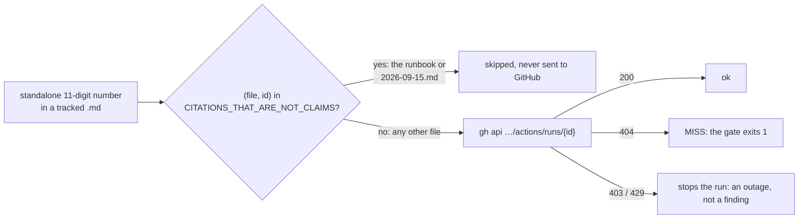

# 2026-10-22 — `just docs-check-citations` is green again: MTN's sandbox MSISDN is not a run

## What this is

`just docs-check-citations` (`cargo xtask verify-citations`) was red on
`master`, on one id: `4673…3454`. That is MTN MoMo's stock sandbox test MSISDN,
the auto-settling payer, not a workflow run. The check reads every standalone,
eleven-digit, non-zero-padded number in a tracked `*.md` as a run of this
repository and asks GitHub for it, and GitHub answers `404`.

The number entered the tree on 2026-09-15 with
[#177](https://github.com/vaam-apps/vpay/pull/177), in
[the live-sandbox runbook](../../runbooks/live-sandbox-test.md) (Step 6 and
"What tripped us up", item 3) and [2026-09-15.md](2026-09-15.md). It was
recorded red on 2026-09-18 by
[2026-09-16-privacy-inventory-gate.md](2026-09-16-privacy-inventory-gate.md),
and again on 2026-10-22 by
[2026-10-22-self-contradictions.md](2026-10-22-self-contradictions.md). The
check is opt-in, so no CI job caught it, but anyone who ran it as
[CONTRIBUTING.md](../../../CONTRIBUTING.md) asks got a red result they did not
cause.

The full number is not printed on this page. A page that printed it would
itself be cited, and would fail the check. See "This page, and #333's" below.

## What changed

- **Two `(file, id)` pairs** joined `CITATIONS_THAT_ARE_NOT_CLAIMS`
  (`.xtask/src/main.rs:8604`): the runbook and the 2026-09-15 page. The brief
  asked for three pairs. That was the three _places_: the runbook writes the
  number twice, and a pair covers a file. The constant now holds five pairs
  for two ids. Its doc comment names both findings: the invented run in three
  mutation records, and this MSISDN.
- **The filter moved into `claims_in`** (`.xtask/src/main.rs:8918`), so a test
  can drive the same code the gate uses. The gate's loop calls it; its
  behaviour is otherwise unchanged.
- **The eleven-digit rule did not change.** `run_id_citations`' doc comment
  (`:9004`) predicted this false failure on 2026-09-05 and stated it "rather
  than fixed". It still does. The next phone number written in a document fails
  the gate the same way and needs its own pair, argued in review.
- [gates.md](../gates.md) says five pairs, not three, with a dated
  correction.

`claims_in` (`:8918`) is the diamond. `verify_citations_via` (`:8731`) makes
the call and reads the answer.

## The test, and what it catches

`the_sandbox_msisdn_is_exempt_only_in_the_files_that_name_it`
(`.xtask/src/main.rs:14081`) feeds the runbook's own Step 6 line through
`claims_in`:

- **in the two named files**, it yields no citation;
- **in three other paths**, it yields `Run` with the number:
  `docs/runbooks/release.md`, `docs/status/verification/2026-10-22.md`, and
  `docs/runbooks/live-sandbox-test.md.bak`. The last one pins an exact path
  match, not a prefix match;
- **in the runbook, next to a real run** (`33929374661`), it still yields the
  run.

`every_exempt_id_is_an_invented_run_or_the_sandbox_msisdn` (`:14054`)
replaces `every_exempt_id_is_the_one_invented_run_in_a_mutation_record`. It
pins the count at five and allows each id only in the files that justify it.
Any other id fails the test. That test's doc comment had moved onto
`a_missing_gh_fails_the_gate_rather_than_skipping`, stacked above that test's
own comment. It is back on its test.

Each mutation below was applied to `.xtask/src/main.rs`, run, and reverted
from a saved copy; the last revert was checked with `cmp`:

| Mutation                                                      | Result                                                                                                                                                |
| ------------------------------------------------------------- | ----------------------------------------------------------------------------------------------------------------------------------------------------- |
| M1: the file match becomes `path.starts_with(file)`           | **caught**: `the_sandbox_msisdn_is_exempt_only_in_the_files_that_name_it` FAILED (the `.bak` path)                                                    |
| M2: the file is ignored, so an exempt id is exempt everywhere | **caught**: same test FAILED (every "elsewhere" path)                                                                                                 |
| M3: the id is ignored, so a named file is exempt wholesale    | **caught**: same test FAILED (the real run in the runbook)                                                                                            |
| M4: the runbook's pair is dropped                             | **caught twice**: first by the compiler (`[(&str, &str); 5]` with four entries), then, with the length set to 4, by both tests: `15 passed; 2 failed` |

## What ran, on 2026-10-22 (macOS arm64)

| Command                                                                                                     | Result                                                                                                                                                                                                                    |
| ----------------------------------------------------------------------------------------------------------- | ------------------------------------------------------------------------------------------------------------------------------------------------------------------------------------------------------------------------- |
| `just docs-check-citations`, **`master`'s** `main.rs`, same docs                                            | **exit 1**: `MISS run 4673…3454 — HTTP 404`. It then stopped on a transport error on this machine (`read tcp …: can't assign requested address`) after 88 ids had answered, so this is the failing line, not a full count |
| `just docs-check-citations`, this change, on `45a244f`                                                      | **exit 0**: `258 unique id(s) cited by 479 markdown file(s) all resolve` (44 runs, 74 PRs, 140 issues), 0 MISS                                                                                                            |
| `just docs-check-citations`, this change merged with `master` at `3eee006`, every docs change here in place | **exit 0**: `277 unique id(s) cited by 482 markdown file(s) all resolve` (54 runs, 78 PRs, 145 issues), 0 MISS; neither exempt id was looked up                                                                           |
| `cargo test -p xtask`                                                                                       | **316 passed, 0 failed, 0 ignored**: 17 in `citation_tests`, one new                                                                                                                                                      |
| `cargo clippy -p xtask --all-targets -- -D warnings`                                                        | clean                                                                                                                                                                                                                     |
| `cargo fmt -p xtask -- --check`                                                                             | clean                                                                                                                                                                                                                     |
| `just verify`, merged with `master` at `3eee006`, this page staged                                          | **ok — the fifteen gates above passed**: `verify-links` 2629 links in 482 files, `verify-doc-counts` 13 counts agree                                                                                                      |
| prettier 3.9.6, the four changed `.md` files                                                                | clean                                                                                                                                                                                                                     |
| `markdownlint-cli2@0.20.0`, super-linter's default config, the same four plus a misaligned control file     | 0 errors in the four; 4 in the control, so the tool ran                                                                                                                                                                   |
| the mermaid block above, rendered with mermaid 11.4.1                                                       | every node and edge label present and on its edge, checked by eye                                                                                                                                                         |

## This page, and #333's

[#333](https://github.com/vaam-apps/vpay/pull/333) merged on 2026-10-22,
before this change. Its page quoted the failing line in full, so it became a
**third** file citing the number. This change drops two middle digits there,
as [2026-09-16-privacy-inventory-gate.md](2026-09-16-privacy-inventory-gate.md)
already does, and adds a dated note. It does not exempt that page. The
exemption is for documents that use the number as a phone number. A page that
quotes the gate's output does not need the digits. With an exemption it would
be the first entry granted for convenience, and the constant's doc comment
says why that path is closed. That page also said "three files" and "three
pairs". The note corrects both: two files, two pairs.

## What did not run, and what was not done

- **Not `just ci`.** The only compiled code that changed is
  `.xtask/src/main.rs`. Its tests, clippy and fmt ran above. CI runs the rest
  on the pull request.
- **No vpay-skills change.** `vaam-apps/vpay-skills` at `c61c9be` names
  `verify-citations` in five files. It names neither
  `CITATIONS_THAT_ARE_NOT_CLAIMS` (a code search finds 0), nor the
  eleven-digit rule, nor a pair count. Nothing it says became false.
- **No stale-exemption check.** If the number leaves one of the two files, its
  pair goes dead and nothing reports it. That was already true of the three pairs for
  the invented run.
- **The check is still in no CI job**, for the reason
  [gates.md](../gates.md) gives: a check that fails when the API rate-limits
  teaches people to re-run it without reading.
