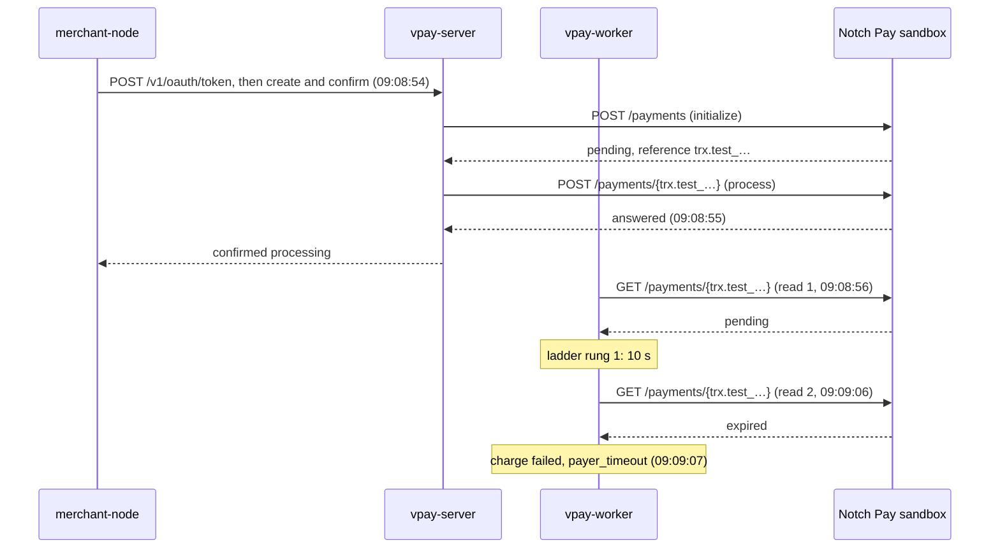
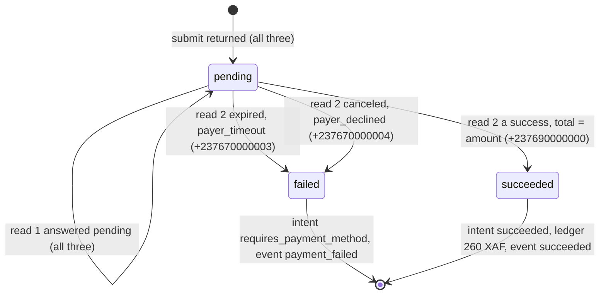

# 2026-10-22 — Notch Pay's timeout, canceled and Orange numbers through vpay: runbook B3b

## What this is, and what it is not

[RFC-0012](../../rfc/0012-notchpay-adapter.md) step 5
([its page](2026-10-21-notchpay-step5.md)) took three of Notch Pay's six
sandbox outcome numbers through vpay on 2026-10-21: `…000000` (MTN success),
`…000001` (MTN insufficient funds) and `…000002` (MTN failure). This page
records the other three, through the same stack: `vpay-server`, its worker
and Postgres, on the `notchpay` adapter, against Notch Pay's real sandbox.

| Number          | Notch Pay documents it as | Amount  |
| --------------- | ------------------------- | ------- |
| `+237670000003` | MTN: timeout              | 240 XAF |
| `+237670000004` | MTN: canceled by user     | 250 XAF |
| `+237690000000` | Orange: success           | 260 XAF |

Until this run, Notch Pay's answer for these three had been read only by
`vpay-notchpay`'s probe, in step 1
([its page](2026-10-21-notchpay-sandbox-run.md)). Nothing in that run went
through the server, the worker or the adapter. The procedure is
[the runbook](../../runbooks/notchpay-sandbox-test.md), Part B (B0, B1, B2),
then B3b.

**It is not** production, and no live key was used. It is not a refund
(`notchpay::refund` is still a `NotImplemented` token), and it is not a
webhook test: runbook A4 was not run, so RFC-0012 § 10 items 7 and 17 stay
open. It is not Orange's failure path either: Notch Pay's testing page lists
no Orange failure number, so there was none to run.

## How it was run

- **Who approved it.** The maintainer, in the running session's own chat,
  chose "Yes, send them". The question was asked once, before any request
  was sent. It named the three numbers and amounts, and every call:
  - one TLS handshake to check the certificate's issuer;
  - per payment, the adapter's initialize (`POST /payments`) and process
    (`POST /payments/{trx.…}`);
  - the worker's reads (`GET /payments/{trx.…}`): once after submit, then
    after waits of 10, 20, 30, 45, 60 and 90 s, then every 120 s. At most
    15 minutes per payment, so at most about 36 reads in all.

  No webhook endpoint, no refund and no other call. Nothing was sent to
  Notch Pay before that answer.

- **From where.** The maintainer's own MacBook (macOS 27.0.1, arm64), in a
  Claude Code desktop session. **Not a cloud session**, and so no
  `--ca-bundle` anywhere: vpay has none and never gains one (ADR-0003).
- **Tree.** The binary was built with `cargo build -p vpay-server` (dev
  profile, rustc 1.98.0), from `master` at `e7406dd`
  (`e7406dda`, v0.10.2), at 05:33Z. At 09:08Z, when the payments ran,
  `master` was `760fbb9` (`760fbb9f`, v0.10.4), and this page's branch is cut
  from it. Between the two, the only changes to anything `vpay-server`
  compiles are the version strings (0.10.2 to 0.10.4). The rest is
  `sandbox_probe.rs` (#334, a cargo example the server does not link),
  `.xtask` (#335), and documentation. So the adapter, the worker and the
  server ran the code `master` holds.
- **Database.** Postgres was `postgres:16-alpine` in Docker on
  `localhost:5434`, as in runbook B0, with one change: the port was published on
  `127.0.0.1` only (`-p 127.0.0.1:5434:5432`). B0's `-p 5434:5432` publishes
  it on every interface of the laptop. B0 is corrected in this change.
- **Keys.** `NOTCHPAY_TEST_PUBLIC_KEY` and `NOTCHPAY_TEST_PRIVATE_KEY` came
  from `~/.config/vpay/notchpay-sandbox.env` (mode 600), outside the
  repository. They were checked by name and property only, and never printed:
  each contains a test marker (`test.` or `test_`). During setup the
  maintainer's chat showed a truncated preview of each key. This page
  quotes none of them.
- **The merchant's keypair** was not regenerated. Step 5's
  `.e2e/notchpay-sandbox-merchant/oauth-signing-key.pem` was copied into this
  checkout's `.e2e/` (git-ignored). This was done after checking that its
  public modulus and its RFC 7638 thumbprint equal the env file's
  `NOTCHPAY_SANDBOX_MERCHANT_JWK_N` and `_KID`. The env file was not changed.
  The OP's own signing key was generated fresh into `secrets/` (git-ignored).
- **Logs.** Step 5's `~/notchpay-server.log` and `~/notchpay-worker.log` were
  moved to `~/notchpay-step5-2026-10-21/` first, so that B1 and B2's `tee`
  would not overwrite them. The runbook's key-absence glob therefore covers
  this run's logs only.
- **When.** The server booted at 05:35:31Z and the worker at 05:35:39Z.
  Neither calls the rail until a charge exists, and `provider_requests` has no
  row before 09:08:54. The approval's exact time was not recorded. The egress
  check, the session's next step after it, ran at 09:08:44Z. The three payments were created between 09:08:54Z
  and 09:09:01Z, and all three were terminal by 09:09:12Z. The last read of
  the database was at 09:12:34Z. Both processes got SIGINT at 09:12:48Z, and
  the container was removed by 09:13:05Z.
- **Mode.** `deployment.livemode` stayed `false`: the server's boot line says
  `livemode=false`.

## Egress

The runbook's ground rule 3 check, with the certificate's subject and the
verification result added:

```text
issuer=C=US, O=Let's Encrypt, CN=YR1
subject=CN=api.notchpay.co
Protocol: TLSv1.3
Verify return code: 0 (ok)
```

No proxy variable was set. **The issuer is a public CA**, the same as on
2026-10-21.

## Boot (B1, B2)

The server's boot matched step 5's line for line, apart from times and the
signing key's `kid`. [Step 5's page](2026-10-21-notchpay-step5.md#boot-b1-b2)
prints all of it. What this run checked:

- `configuration loaded and validated deployment=vpay-notchpay-sandbox
livemode=false providers=1 merchant_clients=1`.
- The ADR-0031 public-key `WARN` (condition 4), from the server at
  05:35:31.020Z and from the worker at 05:35:39.323Z.
- `listening addr=127.0.0.1:8080` and `observability listener listening
(/livez, /metrics) addr=127.0.0.1:9090`. The `--observability-bind` that
  step 5 added to B1 keeps that listener on loopback. The worker's is on
  `127.0.0.1:9091`.
- `GET /healthz` on 8080 answered `200`, and so did `/livez` on 9090 and on 9091.

## The payments (B3b)

The runbook's B3b loop as run (zsh), from the repository root. The `echo`
lines only label each call and record its exit status. `$S` is the
session's scratch folder.

```bash
for pair in 237670000003:240 237670000004:250 237690000000:260; do n=${pair%%:*}; amt=${pair##*:}; echo "== $n amount=$amt start=$(date -u +%FT%TZ)" | tee -a $S/b3b.log; VPAY_BASE_URL=http://localhost:8080 VPAY_CLIENT_ID=notchpay-sandbox-merchant \
  VPAY_PRIVATE_KEY_FILE=.e2e/notchpay-sandbox-merchant/oauth-signing-key.pem \
  VPAY_RAIL=notchpay VPAY_PAYER_MSISDN=$n VPAY_AMOUNT=$amt VPAY_ORDER="np-$n-$(date +%s)" \
    node examples/merchant-node/index.mjs 2>&1 | tee -a $S/b3b.log; echo "exit ${pipestatus[1]} end=$(date -u +%FT%TZ)" | tee -a $S/b3b.log; sleep 2; done
```

The output, verbatim:

```text
== 237670000003 amount=240 start=2026-10-22T09:08:54Z
created pi_88g5wwe8bn78v9mvn2t51cqm requires_payment_method
confirmed processing
exit 0 end=2026-10-22T09:08:55Z
== 237670000004 amount=250 start=2026-10-22T09:08:57Z
created pi_bexwr6j8wh4t7acrze4jbnv2 requires_payment_method
confirmed processing
exit 0 end=2026-10-22T09:08:58Z
== 237690000000 amount=260 start=2026-10-22T09:09:00Z
created pi_pz5b7b8brd2vqan8hcawf8v6 requires_payment_method
confirmed processing
exit 0 end=2026-10-22T09:09:01Z
```

| Number          | Documented as        | Amount  | Intent                        | Charge                        |
| --------------- | -------------------- | ------- | ----------------------------- | ----------------------------- |
| `+237670000003` | MTN timeout          | 240 XAF | `pi_88g5wwe8bn78v9mvn2t51cqm` | `ch_0span5z15n3jb8w6d3t80c6c` |
| `+237670000004` | MTN canceled by user | 250 XAF | `pi_bexwr6j8wh4t7acrze4jbnv2` | `ch_t42a9ef25x0255asane4yj3t` |
| `+237690000000` | Orange success       | 260 XAF | `pi_pz5b7b8brd2vqan8hcawf8v6` | `ch_af2a95ty9h1kffznmesjamwq` |

One payment, as it happened. The times are `+237670000003`'s, from
`provider_requests` and the charge's `updated_at`. The other two followed the
same sequence, three and six seconds later.



## The state, read from Postgres

Right after the loop, at 09:09:08Z, while the worker was still polling:

```sql
select id, state, provider_ref_extra, to_char(updated_at,'HH24:MI:SS.MS') updated from charges order by created_at
```

```text
             id              |  state  |                     provider_ref_extra                      |   updated
-----------------------------+---------+-------------------------------------------------------------+--------------
 ch_0span5z15n3jb8w6d3t80c6c | failed  | {"notchpay_reference": "trx.test_VmHophLVz8tS9MpAf6ctv1RI"} | 09:09:07.183
 ch_t42a9ef25x0255asane4yj3t | pending | {"notchpay_reference": "trx.test_cryqCai6p83TKsUK26Q0md6m"} | 09:08:59.136
 ch_af2a95ty9h1kffznmesjamwq | pending | {"notchpay_reference": "trx.test_yMlLrFaNBcSOAIUe1PONDEge"} | 09:09:02.146
(3 rows)
```

**Every charge held a `notchpay_reference` of the form `trx.test_…` after
submit.**

At 09:09:35Z, 34 seconds after the last payment, the runbook's two B3
queries, as written. Query 1:

```sql
select pi.id, pi.status, c.state, c.failure_code, c.provider_txn_id is not null as has_txn,
       c.provider_txn_id, c.provider_ref_extra->>'notchpay_reference' as notchpay_reference, c.updated_at
  from payment_intents pi join charges c on c.payment_intent_id = pi.id order by c.created_at
```

```text
             id              |         status          |   state   |  failure_code  | has_txn |          provider_txn_id          |        notchpay_reference         |          updated_at
-----------------------------+-------------------------+-----------+----------------+---------+-----------------------------------+-----------------------------------+-------------------------------
 pi_88g5wwe8bn78v9mvn2t51cqm | requires_payment_method | failed    | payer_timeout  | f       |                                   | trx.test_VmHophLVz8tS9MpAf6ctv1RI | 2026-10-22 09:09:07.183569+00
 pi_bexwr6j8wh4t7acrze4jbnv2 | requires_payment_method | failed    | payer_declined | f       |                                   | trx.test_cryqCai6p83TKsUK26Q0md6m | 2026-10-22 09:09:09.425028+00
 pi_pz5b7b8brd2vqan8hcawf8v6 | succeeded               | succeeded |                | t       | trx.test_yMlLrFaNBcSOAIUe1PONDEge | trx.test_yMlLrFaNBcSOAIUe1PONDEge | 2026-10-22 09:09:12.476916+00
(3 rows)
```

Query 2:

```sql
select object_id, type, created_at from events order by seq
```

```text
          object_id          |             type              |          created_at
-----------------------------+-------------------------------+-------------------------------
 pi_88g5wwe8bn78v9mvn2t51cqm | payment_intent.payment_failed | 2026-10-22 09:09:07.183569+00
 pi_bexwr6j8wh4t7acrze4jbnv2 | payment_intent.payment_failed | 2026-10-22 09:09:09.425028+00
 pi_pz5b7b8brd2vqan8hcawf8v6 | payment_intent.succeeded      | 2026-10-22 09:09:12.476916+00
(3 rows)
```

Beyond the runbook's two, the same minute: each charge's amount, `failure_raw` and times.

```sql
select c.id, c.payment_intent_id, c.amount, c.currency_code, c.failure_raw,
       to_char(c.created_at,'HH24:MI:SS.MS') created, to_char(c.updated_at,'HH24:MI:SS.MS') updated
  from charges c order by c.created_at
```

```text
             id              |      payment_intent_id      | amount | currency_code | failure_raw |   created    |   updated
-----------------------------+-----------------------------+--------+---------------+-------------+--------------+--------------
 ch_0span5z15n3jb8w6d3t80c6c | pi_88g5wwe8bn78v9mvn2t51cqm |    240 | XAF           | expired     | 09:08:54.881 | 09:09:07.183
 ch_t42a9ef25x0255asane4yj3t | pi_bexwr6j8wh4t7acrze4jbnv2 |    250 | XAF           | canceled    | 09:08:58.167 | 09:09:09.425
 ch_af2a95ty9h1kffznmesjamwq | pi_pz5b7b8brd2vqan8hcawf8v6 |    260 | XAF           |             | 09:09:00.934 | 09:09:12.476
(3 rows)
```

The ledger: one transaction, two legs, balanced, for the Orange success
only. There is nothing for the two failures.

```sql
select lt.id as txn, lt.charge_id, le.account, le.direction, le.amount, le.currency_code
  from ledger_transactions lt join ledger_entries le on le.transaction_id = lt.id order by le.id
```

```text
             txn             |          charge_id          |     account      | direction | amount | currency_code
-----------------------------+-----------------------------+------------------+-----------+--------+---------------
 lt_18hj5s6h1h5150xfck13q37x | ch_af2a95ty9h1kffznmesjamwq | payer_clearing   | debit     |    260 | XAF
 lt_18hj5s6h1h5150xfck13q37x | ch_af2a95ty9h1kffznmesjamwq | merchant_payable | credit    |    260 | XAF
(2 rows)
```

vpay's own per-attempt audit rows, `provider_requests`, at 09:12:34Z:

```sql
select pr.id, pr.charge_id, pr.operation, pr.attempt, pr.status_code, pr.error_kind,
       to_char(pr.sent_at,'HH24:MI:SS') sent, to_char(pr.responded_at,'HH24:MI:SS') responded
  from provider_requests pr order by pr.id
```

```text
 id |          charge_id          |  operation   | attempt | status_code | error_kind |   sent   | responded
----+-----------------------------+--------------+---------+-------------+------------+----------+-----------
  1 | ch_0span5z15n3jb8w6d3t80c6c | submit       |       1 |           0 |            | 09:08:54 | 09:08:55
  2 | ch_0span5z15n3jb8w6d3t80c6c | query_status |       1 |           0 | pending    | 09:08:56 | 09:08:56
  3 | ch_t42a9ef25x0255asane4yj3t | submit       |       1 |           0 |            | 09:08:58 | 09:08:58
  4 | ch_t42a9ef25x0255asane4yj3t | query_status |       1 |           0 | pending    | 09:08:58 | 09:08:59
  5 | ch_af2a95ty9h1kffznmesjamwq | submit       |       1 |           0 |            | 09:09:00 | 09:09:01
  6 | ch_af2a95ty9h1kffznmesjamwq | query_status |       1 |           0 | pending    | 09:09:01 | 09:09:02
  7 | ch_0span5z15n3jb8w6d3t80c6c | query_status |       2 |           0 | failed     | 09:09:06 | 09:09:07
  8 | ch_t42a9ef25x0255asane4yj3t | query_status |       2 |           0 | failed     | 09:09:09 | 09:09:09
  9 | ch_af2a95ty9h1kffznmesjamwq | query_status |       2 |           0 | succeeded  | 09:09:12 | 09:09:12
(9 rows)
```

**vpay sent Notch Pay 3 submits and 6 reads**, against the approval's upper
bound of about 36 reads. A `submit` row is the adapter's initialize and
process together; the process call has no row of its own. `status_code` `0`
is `vpay-db`'s sentinel for an attempt the rail answered when the HTTP status
is not something the caller can know (`provider_requests.rs`), not an HTTP
status. `error_kind` `failed` covers both failures; which failure each was
is the charge's `failure_code` and `failure_raw`, above.

**No read was made after a charge was terminal.** At 09:09:35Z no
`poll_charge` job was left in `jobs`. `scan_live_charges`, the ten-minute
scan for live charges, ran at 09:12:02Z (its `attempts` went from 17 to 18)
and added no row: the table read at 09:12:34Z is the one above.

### How long each took

| Number          | Charge created | Charge terminal | Elapsed | On read |
| --------------- | -------------- | --------------- | ------- | ------- |
| `+237670000003` | 09:08:54.881   | 09:09:07.183    | 12.3 s  | 2       |
| `+237670000004` | 09:08:58.167   | 09:09:09.425    | 11.3 s  | 2       |
| `+237690000000` | 09:09:00.934   | 09:09:12.476    | 11.5 s  | 2       |

Each answered `pending` to the read right after submit, and its terminal
status to the next one, ten seconds later. So Notch Pay's sandbox had moved
each payment within about ten seconds of process. How much sooner is not
measured: the ladder has no rung below 10 s. Step 1 could not time these
numbers at all: its poll loop read by vpay's reference, which Notch Pay
answers `404` (RFC-0012 § 10 item 2), so only its final read, about 180 s
after process, saw `expired` and `canceled`. **In the sandbox, the
"timeout" number does not wait out a payer: it reads `expired` within one
rung.** Whether a real unanswered prompt does the same, or waits out the
"expired after 3 hours" of Notch Pay's status table (RFC-0012 § 4), was not
measured and cannot be measured with a test number.



## The worker's log

The runbook's grep (`grep -E "notchpay|charge|poll" ~/notchpay-worker.log | tail -100`)
matched 8 lines, colour codes stripped. Four are boot lines. The four that
carry the result, verbatim:

```text
2026-10-22T09:09:07.194561Z  WARN vpay_worker::handlers: the rail reported a charge as failed job_id=9ec5565d-92a5-47e0-b3eb-45cf622f4ea2 charge_id=ch_0span5z15n3jb8w6d3t80c6c payment_intent_id=pi_88g5wwe8bn78v9mvn2t51cqm failure_code=payer_timeout
2026-10-22T09:09:09.464669Z  WARN vpay_worker::handlers: the rail reported a charge as failed job_id=5b37ec66-06db-407d-b507-b107f7bef34c charge_id=ch_t42a9ef25x0255asane4yj3t payment_intent_id=pi_bexwr6j8wh4t7acrze4jbnv2 failure_code=payer_declined
2026-10-22T09:09:12.492960Z  INFO vpay_db::settlement: a capture was posted to the ledger ledger_transaction_id=lt_18hj5s6h1h5150xfck13q37x charge_id=ch_af2a95ty9h1kffznmesjamwq payment_intent_id=pi_pz5b7b8brd2vqan8hcawf8v6 merchant_id=notchpay-sandbox-merchant amount=260 currency_code=XAF
2026-10-22T09:09:12.494907Z  INFO vpay_worker::handlers: the rail reported a charge as paid job_id=aa7ee1a4-627b-4df0-a430-883cf040094c charge_id=ch_af2a95ty9h1kffznmesjamwq payment_intent_id=pi_pz5b7b8brd2vqan8hcawf8v6
```

Neither log has any other `WARN` or `ERROR` after 09:00Z. The server's log
holds three `client_credentials` token grants to `notchpay-sandbox-merchant`,
at 09:08:54Z, 09:08:58Z and 09:09:00Z, one per payment.

## What matched, and what did not

| Number                    | Expected                                                                                                  | Observed                                                                                                                                                                                        | Match |
| ------------------------- | --------------------------------------------------------------------------------------------------------- | ----------------------------------------------------------------------------------------------------------------------------------------------------------------------------------------------- | ----- |
| `+237670000003` (240 XAF) | read `expired`; charge `failed`, `payer_timeout`; intent `requires_payment_method`; `payment_failed`      | `failure_raw` `expired`; charge `failed`, `payer_timeout`; intent `requires_payment_method`; event `payment_intent.payment_failed`; no ledger entry; 12.3 s, read 2                             | yes   |
| `+237670000004` (250 XAF) | read `canceled`; charge `failed`, `payer_declined`; intent `requires_payment_method`                      | `failure_raw` `canceled`; charge `failed`, `payer_declined`; intent `requires_payment_method`; event `payment_intent.payment_failed`; no ledger entry; 11.3 s, read 2                           | yes   |
| `+237690000000` (260 XAF) | read `complete`, `amounts.total` = amount; intent `succeeded`; one balanced ledger transaction of 260 XAF | charge and intent `succeeded`; `provider_txn_id` `trx.test_yMlLrFaNBcSOAIUe1PONDEge`; event `payment_intent.succeeded`; `lt_18hj5s6h1h5150xfck13q37x`, 260 XAF debit and credit; 11.5 s, read 2 | yes   |
| `provider_ref_extra`      | `notchpay_reference` `trx.test_…` after submit                                                            | present on all three, at 09:09:08Z                                                                                                                                                              | yes   |
| Boot                      | the ADR-0031 public-key `WARN`                                                                            | present, in the server and in the worker                                                                                                                                                        | yes   |

**Nothing differed from the expectations, and nothing in
`vpay-adapter-notchpay/src/mapping.rs` was changed.** The Orange success
is read off the state, not the read's body. vpay logs no response body, and
no extra read was made to capture one: it was not among the approved calls.
The adapter turns a read into `Succeeded` only when its status is
`complete`, `refunded` or `partialy-refunded` and its `amount`,
`amounts.total` and currency are the charge's (`mapping::charge_status`). A
short or missing `amounts.total` would have been `Malformed`, as `…000001`'s
was in step 5. So the `Succeeded` implies that `amounts.total` was 260 XAF.
It does not, strictly, imply the status word `complete`, although a fresh
payment read as refunded would be odd and nothing points to it. Neither the
status word nor the values were recorded.

Where the **runbook** did not match what happened:

- B0's `docker run … -p 5434:5432` publishes Postgres (password `vpay`) on
  every interface of the machine. This run used `-p 127.0.0.1:5434:5432`, and
  B0 is corrected in this change. It is the same class of finding as step 5's
  B1, which left the observability listener on `0.0.0.0:9090`.
- B3b says to give these numbers up to 15 minutes. All three were terminal in
  about 12 s. B3b now says so.

## Teardown

- 2026-10-22T09:12:48Z: SIGINT to the server and the worker. The server
  logged "graceful shutdown complete, exiting". The worker logged
  `job loop stopped … claimed=1734 finished=3 rescheduled=1731
dead_lettered=0 lost=0 released=0 drain=Clean`, then the same. The 1 731
  reschedules are almost all `fan_out_events` (1 647 attempts by 09:09:42Z),
  which found nothing to fan out for the three and a half idle hours before
  the payments. The session ran B1 and B2 as background jobs through `tee`,
  and the SIGINT reached those wrapper shells too. That is why the session's
  job runner reported exit 1 for both. The binaries' own last lines are the
  graceful ones above.
- `docker rm -f vpay-pg-notchpay` removed the database container. Ports 5434,
  8080, 9090 and 9091 were free afterwards.
- No webhook endpoint was created, so there was none to delete in Notch Pay's
  dashboard. `~/notchpay-webhooks/` was not created.
- `secrets/` and `.e2e/`, both git-ignored, hold the OP's signing key
  generated for this run and the copy of step 5's merchant key.

## The key-absence check

The runbook's loop, and an extended pass that adds the hash key and also
greps the session's scratch folder holding every captured output. The output
of both, verbatim:

```text
--- runbook check (~/notchpay-*.log)
NOTCHPAY_TEST_PUBLIC_KEY absent
NOTCHPAY_TEST_PRIVATE_KEY absent
--- extended (hash key too; scratch evidence)
NOTCHPAY_TEST_PUBLIC_KEY absent
NOTCHPAY_TEST_PRIVATE_KEY absent
NOTCHPAY_TEST_HASH_KEY absent
```

Every variable was non-empty, so `grep -F` could not match an empty pattern
and print "absent" falsely: an empty one would have printed "FOUND".

## What this proves, and what it does not

**Proves**, for Notch Pay's sandbox on 2026-10-22 and no further:

- The `notchpay` adapter's initialize, process and read, through
  `vpay-server`, the worker and Postgres, for Notch Pay's MTN timeout number,
  its MTN canceled number and its **Orange** success number. With step 5,
  all six of the documented outcome numbers have now run through vpay.
- `expired` becomes `Failed { payer_timeout }` and `canceled` becomes
  `Failed { payer_declined }` against the real rail, each with intent
  `requires_payment_method` and a `payment_intent.payment_failed` event.
- An Orange payer on `cm.mobile` settles through the same read as MTN's:
  `succeeded`, `provider_txn_id` the `trx.…` reference, one balanced 260 XAF
  ledger transaction.
- In the sandbox, all three outcomes arrive by the worker's second read, about
  12 s after create.

**Does not prove:**

- Orange's failure path. Notch Pay's testing page lists no Orange failure
  number.
- How a real unanswered prompt ends, or how long it takes (above).
- Anything about Notch Pay's production, or a live key's prefix (§ 10 item
  8, a written question).
- Webhooks or signatures: no webhook was received (runbook A4 not run), so
  items 7 and 17 stay open, and verification in vpay is RFC-0014, not built.
- Refunds: `notchpay::refund` is still a `NotImplemented` token, and the
  sandbox answered `403` to every `POST /refunds`
  ([2026-10-22](2026-10-22-notchpay-refunds.md)).
- The Orange read's status word and its `amount` and `amounts.total`
  values, which were not captured.
- The 24 h `unresolved` escalation of step 5's `…000001`, which is still read
  from code and was not observed.

## Gates and tests

Run on 2026-10-22 on the maintainer's MacBook, on this page's branch (cut
from `master` at `760fbb9`), with this change's edits in the tree. The
change is documentation only: this page, the status index, `status.md`'s
banner, `providers.md`, `adapter-notchpay.md`, RFC-0012 and the runbook. No
code changed, so `just ci`, `just test-doc` and the Rust suites were not run.

- `just verify`: **all fifteen gates passed** ("the fifteen gates above
  passed"). Among them, `verify-links`: 2656 repository links in 484 tracked
  Markdown files resolve. `verify-doc-counts`: 13 documented counts in 11 of
  294 files agree; the verification directory's count moved from 102 to 103
  with this page. `check-schema` warned that `cratestack` 0.12.0 is on this
  machine's `PATH`, where the repository pins 0.15.0, and still passed. That
  is this machine's toolchain, not this change.
- `prettier --check` (3.9.6, the repository's pin) on the seven changed
  files: clean.
- markdownlint-cli2 0.20.0 (markdownlint 0.40.0), with super-linter's
  default configuration (`markdownlint/style/prettier`, `MD060` aligned,
  `MD024` siblings only), on the seven changed files: **0 errors**. The
  configuration was checked to be live: it reports `MD060` and `MD040` on a
  file built to break them.
- Both Mermaid diagrams were rendered with Mermaid 11.4.1 in a browser and
  looked at.
